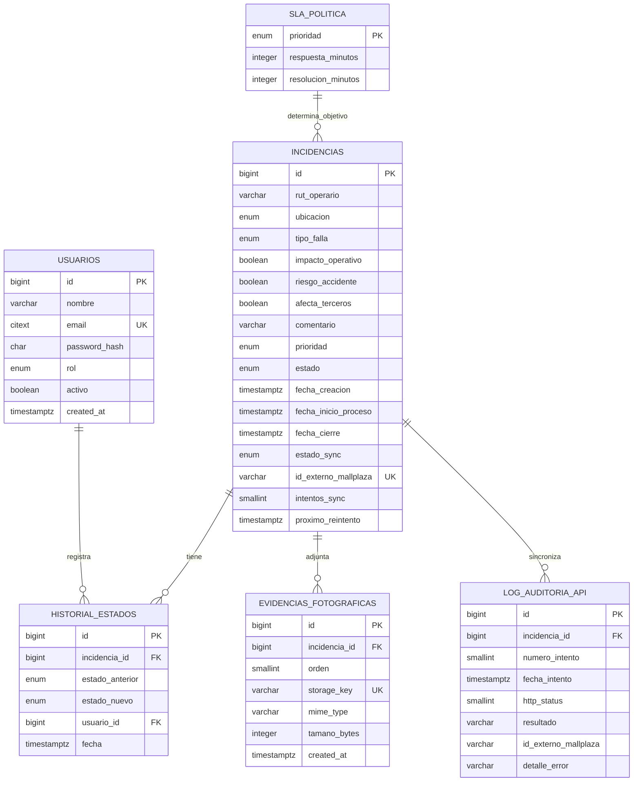

# Modelo de datos, diccionario, KPI y SLA

## 1. Modelo relacional

El modelo físico inicial del prototipo está en `db/schema.sql`; este diagrama lo representa. No agrega entidades ni cambia cardinalidades. La justificación, alcance y revisión del modelo se explican en `justificacion-modelo-datos.md`.

Las relaciones a `historial_estados`, `evidencias_fotograficas` y `log_auditoria_api` son uno-a-muchos; `usuario_id` admite `NULL` para el evento de creación pública. `sla_politica` ofrece un objetivo por prioridad y se relaciona lógicamente por prioridad; no existe FK declarada desde `incidencias.prioridad`, por respeto al esquema de referencia.

## 2. Diccionario de datos

### `usuarios`

| Campo | Tipo | Regla/propósito |
|---|---|---|
| `id` | bigint identity PK | Identificador interno. |
| `nombre` | varchar(120) | Nombre visible para auditoría. |
| `email` | citext UNIQUE | Email insensible a mayúsculas; validación de formato. |
| `password_hash` | char(60) | Hash bcrypt, nunca contraseña; constraint de formato. |
| `rol` | enum `JEFATURA` | Único rol admitido actualmente. |
| `activo` | boolean | Permite invalidar acceso sin borrar historial. |
| `created_at` | timestamptz | Alta del usuario. |

### `incidencias`

| Campo | Tipo | Regla/propósito |
|---|---|---|
| `id` | bigint identity PK | ID del reporte. |
| `rut_operario` | varchar(10) | Identificador personal normalizado; módulo 11. Omitido en listados y logs. |
| `ubicacion` | enum ubicación | `ALTO_TRANSITO`, `TRANSITO_MEDIO`, `BAJO_TRANSITO`. |
| `tipo_falla` | enum tipo | Eléctrica, sanitaria/agua, estructural, estética/confort o mobiliario; no afecta prioridad. |
| `impacto_operativo` | boolean | Factor de clasificación. |
| `riesgo_accidente` | boolean | Factor de clasificación. |
| `afecta_terceros` | boolean | Factor de clasificación. |
| `comentario` | varchar(1000), nullable | Contexto libre opcional. |
| `prioridad` | enum prioridad | Resultado de función determinista. |
| `estado` | enum estado | `PENDIENTE`, `EN_PROCESO`, `RESUELTA`. |
| `fecha_creacion` | timestamptz | Inicio de medición de KPI, default DB. |
| `fecha_inicio_proceso` | timestamptz, nullable | El trigger la fija al entrar en proceso. |
| `fecha_cierre` | timestamptz, nullable | El trigger la fija al resolver. |
| `estado_sync` | enum sync | Pendiente, enviado o error de envío. |
| `id_externo_mallplaza` | varchar(64), UNIQUE, nullable | ID de orden del sistema central una vez acordado. |
| `intentos_sync` | smallint | Contador no negativo de intentos. |
| `proximo_reintento` | timestamptz, nullable | Planificación del worker futuro. |

### Tablas de trazabilidad y adjuntos

| Tabla/campo | Tipo | Regla/propósito |
|---|---|---|
| `historial_estados.id` | bigint identity PK | ID del evento. |
| `historial_estados.incidencia_id` | bigint FK | Incidencia relacionada. |
| `estado_anterior` | enum nullable | Nulo para creación; luego registra estado anterior. |
| `estado_nuevo` | enum NOT NULL | Estado alcanzado. |
| `usuario_id` | bigint FK nullable | Jefatura que hizo el cambio; nulo para reporte público. |
| `fecha` | timestamptz | Momento del evento; tabla inmutable por trigger. |
| `evidencias_fotograficas.id` | bigint identity PK | Identificador de metadato de foto. |
| `incidencia_id` | bigint FK ON DELETE CASCADE | Reporte propietario. |
| `orden` | smallint | 1..3; único por incidencia. |
| `storage_key` | varchar(255) UNIQUE | Ruta/clave de objeto, no contenido binario. |
| `mime_type` | varchar(20) | Solo JPEG, PNG o WebP. |
| `tamano_bytes` | integer | >0 y máximo 2.097.152 bytes. |
| `created_at` | timestamptz | Fecha de registro del archivo. |

### Tablas de integración y política

| Tabla/campo | Tipo | Regla/propósito |
|---|---|---|
| `log_auditoria_api.id` | bigint identity PK | ID de intento de integración. |
| `incidencia_id` | bigint FK | Reporte sincronizado. |
| `numero_intento` | smallint | N° correlativo; único por incidencia junto con el ID. |
| `fecha_intento` | timestamptz | Momento del llamado. |
| `http_status` | smallint nullable | Código 100..599, nulo en error sin respuesta HTTP. |
| `resultado` | varchar(20) | `OK`, `ERROR_HTTP`, `TIMEOUT`, `ERROR_RED`. |
| `id_externo_mallplaza` | varchar(64) nullable | Identificador externo devuelto. |
| `detalle_error` | varchar(500) nullable | Descripción acotada; nunca tokens, llaves ni datos secretos. Tabla inmutable. |
| `sla_politica.prioridad` | enum PK | Una fila por prioridad. |
| `respuesta_minutos` | integer | Objetivo de primera respuesta (dato de política). |
| `resolucion_minutos` | integer | Objetivo de resolución; debe ser >= respuesta. |

### Valores de catálogos

- Rol: `JEFATURA`.
- Ubicación: `ALTO_TRANSITO`, `TRANSITO_MEDIO`, `BAJO_TRANSITO`.
- Tipo: `ELECTRICA`, `SANITARIA_AGUA`, `ESTRUCTURAL`, `ESTETICA_CONFORT`, `MOBILIARIO`.
- Prioridad: `CRITICA`, `ALTA`, `MEDIA`, `BAJA`.
- Estado: `PENDIENTE`, `EN_PROCESO`, `RESUELTA`.
- Estado de integración: `PENDIENTE_SINC`, `ENVIADO`, `ERROR_ENVIO`.

## 3. KPI: definiciones y SMART

Los objetivos numéricos siguientes son **propuesta inicial**, necesitan línea base y aprobación de Jefatura. Medir por mes calendario y segmentar por prioridad. El período de datos se filtra sobre `fecha_creacion` y los cierres se calculan con `fecha_cierre`.

| KPI SMART | Fórmula y unidad | Propuesta de meta | Frecuencia / dueño |
|---|---|---|---|
| MTTR de resolución | Promedio `(fecha_cierre - fecha_creacion)` para resueltas del período, minutos. Mostrar además mediana y percentil 90 para que unos casos extremos no oculten la experiencia típica. | En los primeros 3 meses, establecer baseline; al mes 6 reducir el promedio al menos 15% sin aumentar reaperturas. | Mensual; Jefatura. |
| Cumplimiento SLA de resolución | `resueltas dentro de resolución_minutos / total resueltas × 100`. Cohorte por `fecha_creacion`; definir qué hacer con cierre posterior al período. | >=90% al tercer mes medido y >=95% al sexto, revisado por prioridad. | Semanal y mensual; Jefatura. |
| Incidencias abiertas vencidas | Conteo de abiertas con `(ahora - fecha_creacion) > SLA resolución de prioridad`. Separar `PENDIENTE` y `EN_PROCESO`. | Reducir el promedio semanal al menos 20% entre baseline del mes 1 y mes 3. | Diario/semanal; Jefatura. |
| Volumen por prioridad, tipo y ubicación | Conteo de IDs en período; usar dimensiones enumeradas del esquema. | Medir cobertura de reporte y detectar concentración; baseline inicial antes de definir cuota. | Semanal/mensual; Jefatura. |
| Estado de sincronización | Conteo por `PENDIENTE_SINC`, `ENVIADO`, `ERROR_ENVIO`; una vez activo el worker, agregar tasa y antigüedad. | Cuando exista integración productiva, acordar umbral de pendientes y errores según contrato/volumen. | Cada 15 min/diario (diseño futuro); soporte integración. |
| Disponibilidad del sistema (SLO propuesto) | Minutos disponibles / minutos de servicio acordados × 100; excluir mantenimiento solo si se acuerda. | 99,5% mensual como hipótesis de diseño, sujeto a validación en el plan de servicio. | Mensual; responsable TI. |

**SMART aplicado:** específico (define población y fórmula), medible (unidades/consulta), alcanzable (meta escalonada, no histórica inventada), relevante (menor espera/pendientes), temporal (3/6 meses). Definir baseline, horario de servicio, exclusiones, fuente horaria y responsable antes de comprometer objetivos.

## 4. SLA de prioridad y servicio

### Política funcional definida en la base

| Prioridad | Primera respuesta (min) | Resolución (min) | Equivalencia resolución |
|---|---:|---:|---:|
| Crítica | 15 | 240 | 4 h |
| Alta | 30 | 480 | 8 h |
| Media | 120 | 1.440 | 24 h |
| Baja | 480 | 4.320 | 72 h |

Los valores están en `sla_politica`. La política define umbrales pero Sprint 1 no implementa temporizador, notificación, escalamiento ni pausa por dependencias; esos mecanismos son posteriores. “Primera respuesta” necesita definición operacional (por ejemplo, toma de conocimiento vs. primer cambio a `EN_PROCESO`). El KPI SLA definido en los requisitos es de resolución; no debe mezclarse con el tiempo de respuesta.

### Niveles de servicio TI (propuesta por confirmar)

| Nivel | Servicio esperado | Objetivo inicial propuesto | Medición/contingencia |
|---|---|---|---|
| Disponibilidad | Portal/API accesibles durante horario acordado | 99,5% mensual | Monitor sintético HTTP, CloudWatch, incidente si cae. |
| Respuesta API | Lectura/escritura ordinaria sin latencia excesiva | p95 < 2 s (excluir reportes pesados) | APM/latencias; dimensionar con carga real. |
| Incidentes técnicos P1 | Caída total, pérdida de datos o exposición de RUT | Acuse interno <15 min; mitigación prioritaria <4 h como objetivo inicial | Canal de escalamiento y responsable de guardia aún por acordar. |
| RPO/RTO | Datos máximos perdibles/tiempo de restauración | RPO <=15 min, RTO <=4 h propuestos | Requiere arquitectura de backup/PITR y simulacro antes de afirmar cumplimiento. |
| Integración externa | Entrega confiable a Casa Central | Objetivo a establecer durante la fase de integración | Definir latencia, ventana, reintentos e idempotencia con contraparte técnica. |

Estos SLA TI son una propuesta académica para traducir expectativas a mediciones. La disponibilidad real, el horario, soporte, exclusiones, mantenimiento, RTO/RPO y consecuencias deben ser pactados por el cliente; no prometerlos solo por dibujar la arquitectura.

## 5. Notas de revisión (10-oct-2026)

- **SLA operativo y SLA de plataforma.** Los tiempos de la sección 4 (15/30/120/480 min de primera respuesta y 4/8/24/72 h de resolución) son el SLA **operativo**: qué tan rápido se atiende cada incidencia del mall. El Informe 1 usa la misma matriz para el soporte del software; se propone llamar a ese segundo conjunto "severidades S1 a S4" para no confundirlos.
- **Disponibilidad.** El Informe 1 promete 99,9 %, pero presupuesta una instancia EC2 t3.micro y RDS en una sola zona, configuración que no lo respalda. Decidir entre bajar el objetivo (por ejemplo al 99,5 % de la sección 4) o presupuestar alta disponibilidad (decisión D10).
- **Documento ampliado.** Los 10 KPI con las cinco dimensiones SMART y los niveles de servicio completos están en `docs/entregables/capitulo-analisis-diseno.md`, secciones 7.1 y 7.2.

