# Capítulo X. Análisis, diseño y planificación técnica de la solución

Este capítulo reúne el análisis comparativo y la factibilidad del proyecto, el modelado de procesos y de la solución, los indicadores y niveles de servicio, el plan de pruebas y las normas aplicadas, para el Sistema de Gestión y Trazabilidad de Incidencias Operativas de Mallplaza Copiapó. **Es un borrador:** las cifras que dependen de decisiones pendientes con el cliente están señaladas y se resumen en el Anexo B. El estado de implementación corresponde al prototipo local al 10 de octubre de 2026; nada de lo descrito para AWS está desplegado.

| Sección | Criterio de la pauta |
|-------------------------|----------------------------------|
| 1. Análisis comparativo y factibilidad | 2.1.1.1 Análisis comparativo tecnológico y metodológico |
| 2. Herramientas y componentes | 2.1.1.2 Descripción de herramientas y componentes |
| 3. Modelado BPMN | 2.1.2.3 BPMN de procesos de negocio |
| 4. Diagramas UML | 2.1.2.4 UML de casos de uso y de componentes |
| 5. Modelo y diccionario de datos | 2.1.2.5 Modelo y diccionario de datos |
| 6. Topología, infraestructura y arquitectura TI | 2.1.2.6, 2.1.2.7 y 2.1.2.8 |
| 7. KPI SMART y niveles de servicio | 2.1.3.9 y 2.1.3.10 |
| 8. Plan de pruebas | 2.1.4.11 Plan de pruebas de software |
| 9. Normas y estándares | 2.1.4.12 Normas y estándares aplicados |

: Tabla 1. Correspondencia entre las secciones del capítulo y la pauta. Fuente: Elaboración propia.

## 1. Análisis comparativo y factibilidad

### 1.1 Comparación de metodologías

Se compararon Scrum, Kanban, XP y Cascada con siete criterios que reflejan las restricciones del proyecto: 15 semanas, tres integrantes, requisitos sujetos a validación del cliente y evaluación académica. Los puntajes (1 a 5) son una evaluación del equipo, no una medición, y su fundamento está en el modelo de cálculo que acompaña a este capítulo.

| Criterio | Peso | Scrum | Kanban | XP | Cascada |
|----------------------------|------|------|------|------|------|
| Adaptación a requisitos cambiantes o pendientes de validación | 25 % | 5 | 4 | 5 | 1 |
| Entregas incrementales verificables en 15 semanas | 20 % | 5 | 3 | 4 | 2 |
| Adecuación a un equipo de 3 personas | 15 % | 4 | 5 | 3 | 3 |
| Trazabilidad y evidencia documental para la evaluación | 15 % | 4 | 3 | 2 | 5 |
| Gestión temprana de riesgos de integración | 10 % | 5 | 3 | 4 | 1 |
| Participación frecuente del sponsor | 10 % | 5 | 3 | 5 | 2 |
| Curva de aprendizaje y costo de adopción | 5 % | 4 | 5 | 2 | 5 |
| **Resultado ponderado (0 a 100)** | 100 % | **93,0** | **73,0** | **76,0** | **48,0** |

: Tabla 2. Matriz ponderada de metodologías de desarrollo. Fuente: Elaboración propia.

Scrum queda primero en los tres escenarios de sensibilidad probados: sin el criterio de trazabilidad documental (95,3 frente a 82,4 de XP), con todos los pesos iguales (91,4 frente a 74,3 de Kanban) y sin el criterio de equipo pequeño (95,3 frente a 78,8 de XP). Se mantiene Scrum, con sprints de 2 a 3 semanas, porque la adaptación al cambio y las entregas tempranas son lo más relevante mientras el contrato con Casa Central sigue abierto.

*Limitación.* El Proxy Product Owner (Luis Henríquez) también es desarrollador. Para que ese rol no se diluya, el sponsor (Gerencia de Mallplaza) debe validar el backlog en cada revisión de sprint.

### 1.2 Comparación de tecnologías

Los pesos y puntajes provienen de la selección tecnológica del proyecto. Como el criterio de ajuste al stack definido favorece a lo ya elegido, se recalculó sin él para comprobar que la conclusión se mantiene.

| Decisión | Opción elegida | Alternativas | Resultado | Sin el criterio de ajuste |
|--------|------------|----------------|------------|------------|
| Backend | Node.js 20 + Express | Python + Django REST; Java + Spring Boot | 92 frente a 68 y 65 | 89,3 frente a 77,3 y 73,3 |
| Base de datos | PostgreSQL | MySQL; MongoDB | 100 frente a 80 y 54 | 100 frente a 83,5 y 56,5 |

: Tabla 3. Resultado de la comparación de tecnologías (0 a 100). Fuente: Elaboración propia.

PostgreSQL gana por integridad relacional (claves foráneas, restricciones y triggers), consultas de agregación para los KPI y un historial auditable que el esquema ya usa. Node.js gana por velocidad de desarrollo, un único lenguaje para frontend y backend y su ecosistema de pruebas. En el frontend se eligió Vite con PWA frente a Next.js, porque el formulario no necesita renderizado en servidor, y Chart.js frente a ECharts por ser suficiente para los KPI. *El presupuesto del Informe 1 cotiza RDS para MySQL; el sistema usa PostgreSQL y debe corregirse (Anexo B, D9).*

### 1.3 Factibilidad técnica

El proyecto es técnicamente factible. El prototipo cubre 31 de los 40 requerimientos funcionales y superó 33 pruebas automatizadas y 45 de 46 casos ejecutados contra el backend, con un hallazgo de seguridad.

| Aspecto | Evidencia | Riesgo | Mitigación |
|------------|--------------------|------|--------------------|
| Integración con Casa Central | Cliente simulado y auditoría probados; contrato sin definir | Alto | Adaptador aislado, reintentos diseñados y cierre del contrato con TI de Mallplaza |
| Lectura del QR en celulares | Sin prueba en iPhone ni Android | Medio | Probar en dispositivos reales; la cámara en PWA exige HTTPS |
| Capacidad de la instancia t3.micro | 20 envíos simultáneos locales sin errores; sin prueba de carga real | Medio | Prueba de carga con el volumen esperado |
| Seguridad y datos personales | bcrypt, RUT fuera de registros; el token de sesión no se revoca al cerrar sesión (8 horas) | Medio | Acortar la vigencia o revocar; política según Ley 21.719 |
| Disponibilidad | Una instancia y base de datos en una sola zona | Medio | Ajustar el objetivo o presupuestar alta disponibilidad |

: Tabla 4. Evaluación de factibilidad técnica. Fuente: Elaboración propia.

### 1.4 Factibilidad económica

El Informe 1 estima 15 incidencias diarias coordinadas de forma informal, con 15 minutos perdidos cada una: 75 horas-hombre al mes que, a $5.000 por hora, equivalen a **$375.000 CLP mensuales** de desperdicio (sin medir). El costo operativo de la nube es de $42.500 CLP al mes. La inversión inicial es de $3.932.000 CLP según el Informe 1 y de $3.506.000 CLP según el documento de definición arquitectónica; la diferencia de $426.000 debe reconciliarse (Anexo B, D12).

| Captura del ahorro | Ahorro neto mensual | Recuperación (Informe 1) | Recuperación ($3.506.000) | Acumulado neto a 5 años |
|--------|------------|------------|------------|------------|
| 100 % | $332.500 | 11,8 meses | 10,5 meses | $16.018.000 |
| 75 % | $238.750 | 16,5 meses | 14,7 meses | $10.393.000 |
| 50 % | $145.000 | 27,1 meses | 24,2 meses | $4.768.000 |
| 25 % | $51.250 | 76,7 meses | 68,4 meses | −$857.000 |

: Tabla 5. Recuperación de la inversión según la parte del ahorro que el sistema logre capturar (presupuesto del Informe 1). Fuente: Elaboración propia.

Recuperar la inversión en menos de cinco años, como afirma el Informe 1, exige capturar al menos el **28,8 %** del ahorro; en menos de tres años, el **40,5 %**. Es una meta razonable, pero depende de una estimación no medida, por lo que conviene medir la línea base durante la marcha blanca. El costo de recursos humanos valora las horas de los estudiantes bajo el modelo de fábrica de software y no es un desembolso de Mallplaza; el costo operativo debe validarse con una cotización formal de AWS.

### 1.5 Factibilidad implementativa

El proyecto es factible con condiciones. Desde el 10 de octubre quedan unas 8 semanas hasta el cierre del 6 de diciembre de 2026, y el trabajo restante se estimó en 5 a 7 semanas, por lo que la holgura es escasa.

| Riesgo | Prob. | Impacto | Mitigación |
|---------------------|------|------|-------------------------|
| El contrato de Casa Central no llega a tiempo | Alta | Alto | Seguir con el cliente simulado, adaptador aislado y fecha acordada con TI |
| Los operarios no adoptan el QR | Media | Alto | Capacitación ($72.000 presupuestados), prueba con 2 o 3 operarios y KPI de trazabilidad digital |
| El alcance excede el tiempo restante | Media | Medio | Priorizar los Must have y congelar funciones antes de la demo |
| Cambios de requisitos del cliente | Alta | Medio | Scrum con revisiones de sprint y registro de decisiones pendientes |
| Costos de AWS mayores a lo presupuestado | Media | Medio | Cotización formal y alarmas de presupuesto |
| Falla de seguridad o de protección de datos | Baja a media | Alto | Corregir la vigencia del token, política de la Ley 21.719 y revisión de accesos |
| Falta de continuidad después del 6 de diciembre | Media | Alto | Acta de entrega, manual de operación y responsable designado en Mallplaza |

: Tabla 6. Riesgos de implementación (probabilidad e impacto estimados por el equipo). Fuente: Elaboración propia.

## 2. Herramientas y componentes

Todo el software de desarrollo es gratuito o de código abierto; el Informe 1 no contempla licencias pagadas. Las versiones son las mínimas declaradas en el proyecto.

| Categoría | Herramienta | Versión | Rol |
|--------|--------------------|--------|----------------------|
| Lenguajes | JavaScript, SQL, HTML y CSS | — | Todo el sistema |
| Ejecución | Node.js | 20 | Servidor de la API |
| Backend | Express; pg; zod | 4.21; 8.13; 3.24 | Rutas REST; acceso a PostgreSQL con SQL parametrizado; validación de entradas |
| Seguridad | bcrypt; jsonwebtoken y cookie-parser; express-rate-limit | 6.0; 9.0 y 1.4; 7.5 | Contraseñas; sesión de Jefatura en cookie protegida; límite de solicitudes |
| Registros | pino y pino-http; dotenv | 9.6 y 10.4; 16.4 | Registros estructurados sin datos sensibles; variables de entorno |
| Base de datos | PostgreSQL; node-pg-migrate | 16; 8.0 | Datos, historial y auditoría; migraciones reproducibles |
| Frontend | Vite; vite-plugin-pwa | 7.3; 2.0 | Compilación y PWA instalable, sin librerías de ejecución |
| Calidad | Vitest y Supertest; ESLint y Prettier | 4.1 y 7.0; 9 y 3.5 | Pruebas unitarias y de integración; análisis y formato |
| Entorno | Docker y Docker Compose; Git y GitHub; npm | — | Entorno reproducible y control de versiones |
| Integración continua | GitHub Actions | — | Lint, pruebas y compilación (propuesto, aún sin ejecutar en GitHub) |
| Modelado | PlantUML, Mermaid, bpmn.io o Camunda Modeler | — | UML, diagramas y BPMN 2.0 |
| Nube (objetivo) | Elastic Beanstalk y EC2 t3.micro; RDS db.t3.micro; S3, CloudWatch, Secrets Manager | — | Aplicación, base de datos, archivos, monitoreo y secretos |
| Servicio externo | API de Casa Central | — | Órdenes de trabajo (contrato pendiente) |
| Hardware | Teléfonos de operarios; notebook o PC de Jefatura; notebooks de desarrollo (4 núcleos, 8 GB de RAM) | — | Captura por QR; gestión y dashboard; desarrollo y pruebas |

: Tabla 7. Inventario de herramientas, lenguajes y componentes. Fuente: Elaboración propia.

Multer (carga de fotos) y Chart.js (gráficos del dashboard) están previstos en la guía del proyecto pero aún no están instalados.

## 3. Modelado BPMN de los procesos de negocio

Se modelaron tres procesos principales en su versión rediseñada (TO-BE), con ocho subprocesos, en notación BPMN 2.0. El relleno de cada actividad indica su estado en el prototipo: blanco, implementado y probado; amarillo, parcial; naranja, simulado o pendiente. Los archivos `.bpmn` editables se entregan aparte. Las actividades enlazan con los casos de uso y requerimientos del apartado 4 y del Anexo A.

### 3.1 Proceso 1: reporte y priorización de incidencias

El operario detecta una falla, escanea el QR y completa el formulario. El sistema valida el reporte; si hay datos incorrectos, se le indican y el operario los corrige. Si todo es correcto, el motor de reglas calcula la prioridad, se registra la incidencia como Pendiente con su fecha y primera entrada de historial, y se confirma al operario con el número y la prioridad.

[[LS]]

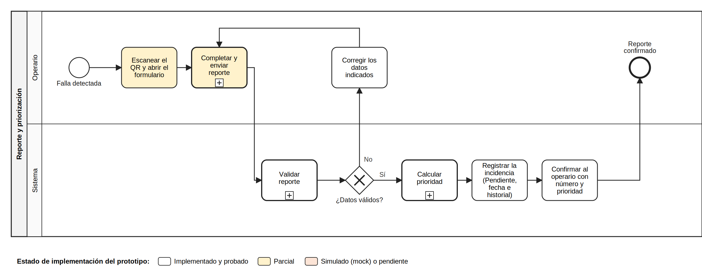

Los tres subprocesos son: **Completar y enviar reporte** (RUT, ubicación, tipo de falla, impacto, riesgo, terceros, comentario y fotos opcionales); **Validar reporte** (límite de envíos, campos obligatorios, RUT con módulo 11 y catálogos); y **Calcular prioridad**, que evalúa cuatro reglas en orden y se detiene en la primera que se cumple: impacto operativo en alto tránsito da Crítica; riesgo de accidente o afecta a terceros da Alta; alto tránsito o impacto operativo da Media; en otro caso, Baja.

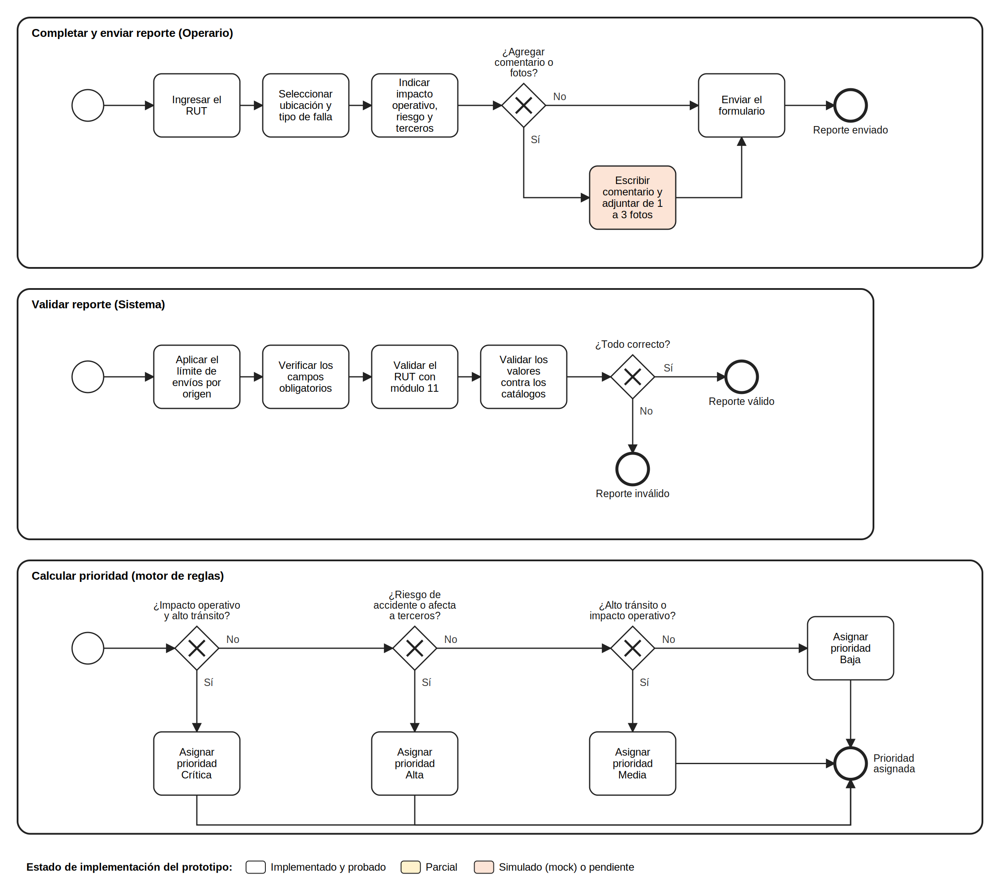

### 3.2 Proceso 2: gestión y cierre de incidencias

La Jefatura inicia sesión y consulta la cola priorizada; si lo necesita, filtra o busca. Revisa el detalle y el historial y cambia el estado de la incidencia. El sistema valida y registra el cambio; si no es válido, lo rechaza y el estado no se modifica. Si es válido y la incidencia aún no está Resuelta, la atención continúa en terreno, fuera del sistema, y se repite el cambio. Al quedar Resuelta se actualizan los indicadores y la incidencia se cierra.

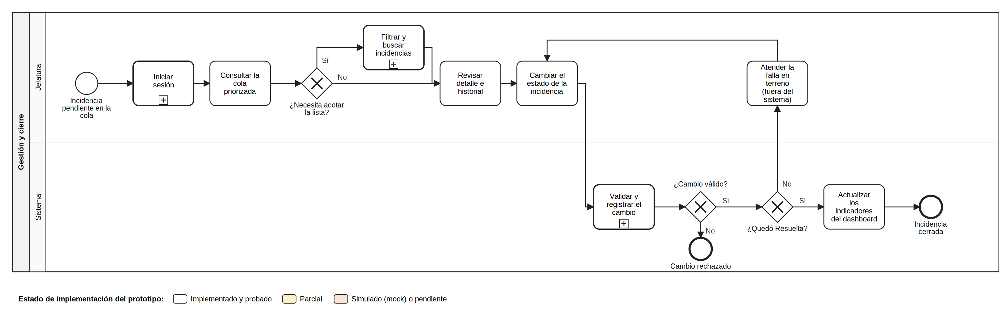

Subprocesos: **Iniciar sesión** (validación de credenciales con límite de intentos y sesión en cookie protegida); **Filtrar y buscar** (por estado, prioridad, ubicación, tipo de falla o número); y **Validar y registrar el cambio**, que solo admite transiciones hacia adelante y exige haber pasado por En proceso antes de Resuelta, guardando estado, fechas e historial en una sola operación.

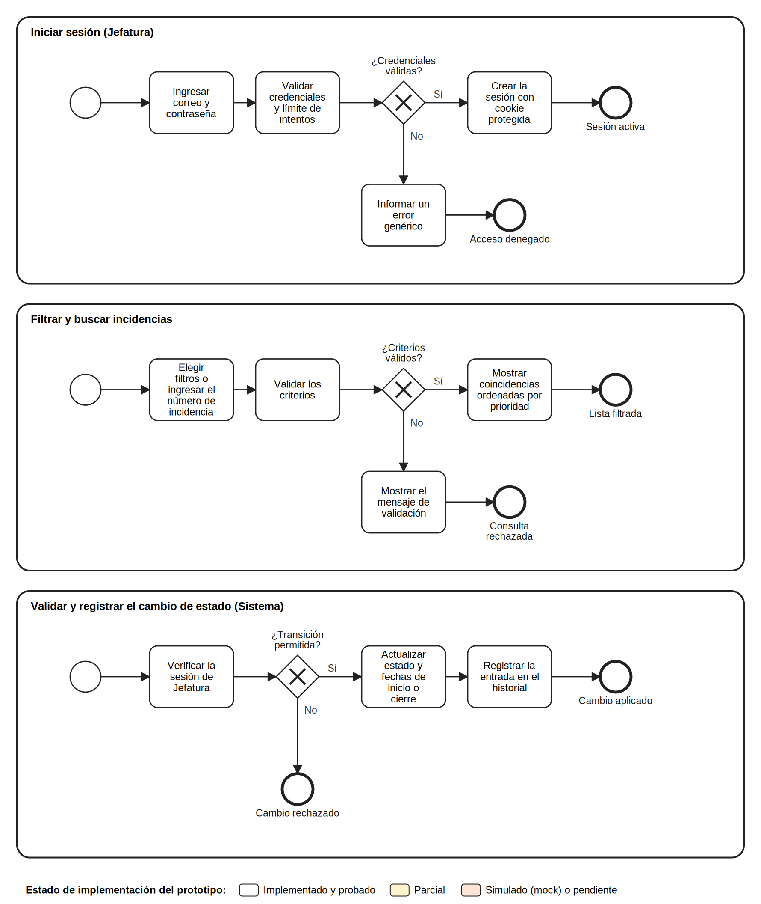

### 3.3 Proceso 3: sincronización con Casa Central

Una incidencia pendiente de sincronizar entra al proceso. El sistema prepara el mensaje y envía una petición POST cifrada a Casa Central, registra cada intento en la auditoría y, si la respuesta trae el identificador de la orden de trabajo, lo guarda y marca la incidencia como Enviada. Si falla, comprueba si quedan reintentos: espera el intervalo y vuelve a enviar, o marca la incidencia con Error de envío, visible en el dashboard. Este proceso está hoy simulado: no existe la llamada real ni el worker de reintentos.

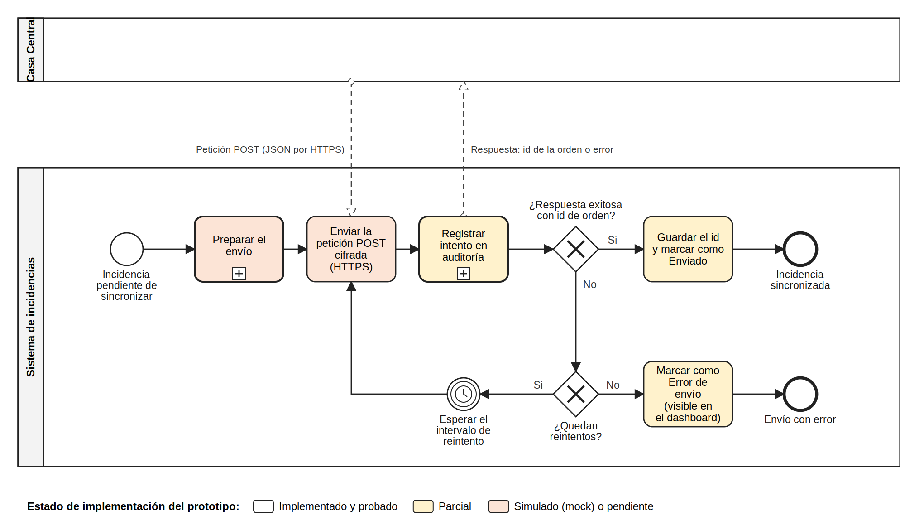

Subprocesos: **Preparar el envío** (leer dirección y credenciales de variables de entorno y armar el JSON) y **Registrar intento en auditoría** (fecha, hora, resultado y código HTTP, con detalle sanitizado).

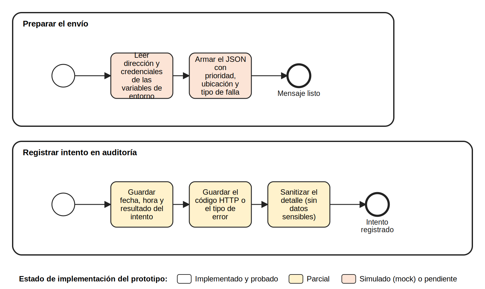

[[LE]]

## 4. Diagramas UML

### 4.1 Casos de uso

Los actores son el **Operario** (reporta desde el celular, sin sesión), la **Jefatura** (única con credenciales), **Casa Central** (sistema externo que recibe las incidencias) y el **Sistema** (casos automáticos). Se identificaron 14 casos de uso que cubren los 40 requerimientos funcionales.

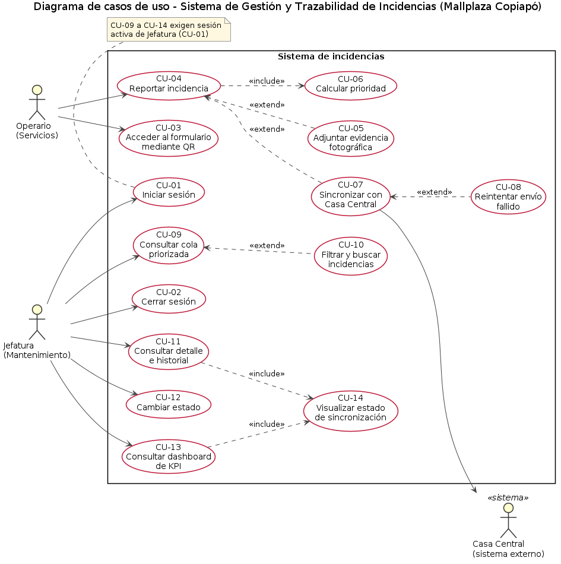

| ID | Caso de uso | Actor principal | RF y RNF | Estado |
|----|----------------|-----------|---------------|-----------|
| CU-01 | Iniciar sesión | Jefatura | RF-01, RF-02, RNF-05, RNF-06 | Implementado y probado |
| CU-02 | Cerrar sesión | Jefatura | RF-03 | Implementado y probado |
| CU-03 | Acceder al formulario mediante QR | Operario | RF-04, RNF-01 | Parcial |
| CU-04 | Reportar incidencia | Operario | RF-05 a RF-11, RF-14, RF-15, RNF-12 | Implementado y probado |
| CU-05 | Adjuntar evidencia fotográfica | Operario | RF-12, RF-13, RF-35, RNF-11 | Pendiente |
| CU-06 | Calcular prioridad | Sistema | RF-16, RF-17, RF-18 | Implementado y probado |
| CU-07 | Sincronizar con Casa Central | Sistema y Casa Central | RF-36, RF-37, RF-38 | Simulado |
| CU-08 | Reintentar envío fallido | Sistema | RF-38, RF-39 | Pendiente |
| CU-09 | Consultar cola priorizada | Jefatura | RF-02, RF-33 | Implementado y probado |
| CU-10 | Filtrar y buscar incidencias | Jefatura | RF-23 a RF-27 | Implementado y probado |
| CU-11 | Consultar detalle e historial | Jefatura | RF-22, RF-35 | Implementado y probado |
| CU-12 | Cambiar estado de una incidencia | Jefatura | RF-19, RF-20, RF-21, RF-34 | Implementado y probado |
| CU-13 | Consultar dashboard de KPI | Jefatura | RF-02, RF-28 a RF-32 | Implementado y probado |
| CU-14 | Visualizar estado de sincronización | Jefatura | RF-40 | Implementado |

: Tabla 8. Catálogo de casos de uso. Fuente: Elaboración propia.

Las relaciones **include** son: CU-04 incluye CU-06; CU-11 y CU-13 incluyen CU-14. Las relaciones **extend** son: CU-05 y CU-07 amplían CU-04; CU-08 amplía CU-07; CU-10 amplía CU-09. Los casos CU-09 a CU-14 exigen sesión activa de Jefatura (CU-01). A continuación se especifican los cuatro casos centrales; las 14 especificaciones completas, con precondiciones, flujos alternativos y reglas, están en el documento de especificación de casos de uso que acompaña al informe.

| Campo | Contenido |
|----------|-------------------------------------------------|
| Actor | Operario |
| Precondición | Formulario cargado con sus listas (CU-03) |
| Flujo principal | 1. Ingresa el RUT. 2. Selecciona la ubicación. 3. Selecciona el tipo de falla. 4. Indica impacto operativo, riesgo de accidente y si afecta a terceros. 5. Opcionalmente agrega comentario y fotos. 6. Envía. 7. El sistema valida campos obligatorios y RUT. 8. Calcula la prioridad (CU-06). 9. Registra la incidencia en estado Pendiente con fecha y hora automáticas. 10. Confirma con número y prioridad, sin mostrar el RUT. 11. Deja la incidencia lista para sincronizar (CU-07) sin hacer esperar al operario. |
| Flujos alternativos | A1. Campo faltante o RUT inválido: se indica el error y no se envía. A2. Exceso de envíos: rechazo temporal. A3. Falla del servidor: no se crean registros parciales. A4. Casa Central no disponible: no afecta el reporte. |
| Postcondición | Incidencia guardada con prioridad y visible en la cola de Jefatura |
| Reglas | El RUT es solo identificador de responsabilidad, sin validación cruzada; no aparece en listas ni registros (RNF-10) |

: Tabla 9. Especificación del caso de uso CU-04, Reportar incidencia. Fuente: Elaboración propia.

| Campo | Contenido |
|----------|-------------------------------------------------|
| Actor | Sistema (incluido en CU-04) |
| Flujo principal | Evalúa en orden y se detiene en la primera regla que se cumple: 1. Impacto operativo y alto tránsito: Crítica. 2. Riesgo de accidente o afecta a terceros: Alta. 3. Alto tránsito o impacto operativo: Media. 4. Otro caso: Baja. Guarda la prioridad con la incidencia. |
| Reglas | Determinista y sin intervención humana; el tipo de falla no influye |
| Estado | Implementado y probado (24 combinaciones) |

: Tabla 10. Especificación del caso de uso CU-06, Calcular prioridad. Fuente: Elaboración propia.

| Campo | Contenido |
|----------|-------------------------------------------------|
| Actores | Sistema (principal) y Casa Central (secundario) |
| Precondición | Incidencia registrada con sincronización pendiente; credenciales en variables de entorno; comunicación por HTTPS con TLS 1.2 o superior |
| Flujo principal | 1. Arma el JSON con prioridad, ubicación y tipo de falla. 2. Envía un POST cifrado. 3. Casa Central responde con el identificador de la orden. 4. El sistema lo guarda y marca la incidencia como enviada. 5. Registra el intento en la auditoría con fecha, hora y código de respuesta. |
| Flujos alternativos | A1. Error HTTP, tiempo agotado o falla de red: se audita el intento y queda pendiente de reintento (CU-08). A2. Respuesta sin identificador: se trata como error. |
| Reglas | La espera por Casa Central nunca bloquea al operario (RNF-14) |
| Estado | Simulado; el contrato real está pendiente |

: Tabla 11. Especificación del caso de uso CU-07, Sincronizar con Casa Central. Fuente: Elaboración propia.

| Campo | Contenido |
|----------|-------------------------------------------------|
| Actor | Jefatura |
| Precondición | Sesión activa; la incidencia está Pendiente o En proceso |
| Flujo principal | 1. Desde el detalle, pasa la incidencia a En proceso. 2. El sistema valida la transición y registra fecha de inicio e historial. 3. Al terminar el trabajo, la marca como Resuelta. 4. El sistema verifica que haya pasado por En proceso. 5. Registra fecha de cierre e historial. 6. Los indicadores se actualizan. |
| Flujos alternativos | A1. Pendiente a Resuelta, o retroceder: rechazo con conflicto (409). A2. Ya Resuelta: rechazo. A3. Falla durante el cambio: se revierte todo. |
| Reglas | Las transiciones solo avanzan; el cambio y su historial se guardan juntos |

: Tabla 12. Especificación del caso de uso CU-12, Cambiar estado de una incidencia. Fuente: Elaboración propia.

### 4.2 Componentes

El sistema se organiza en tres capas: presentación (PWA en el navegador), lógica de negocio (API Express con módulos de autenticación, incidencias, motor de reglas, KPI y seguridad transversal) y datos (PostgreSQL). El cliente de Casa Central y la auditoría de API están simulados o parciales; el worker de reintentos y el almacenamiento de evidencias están pendientes.

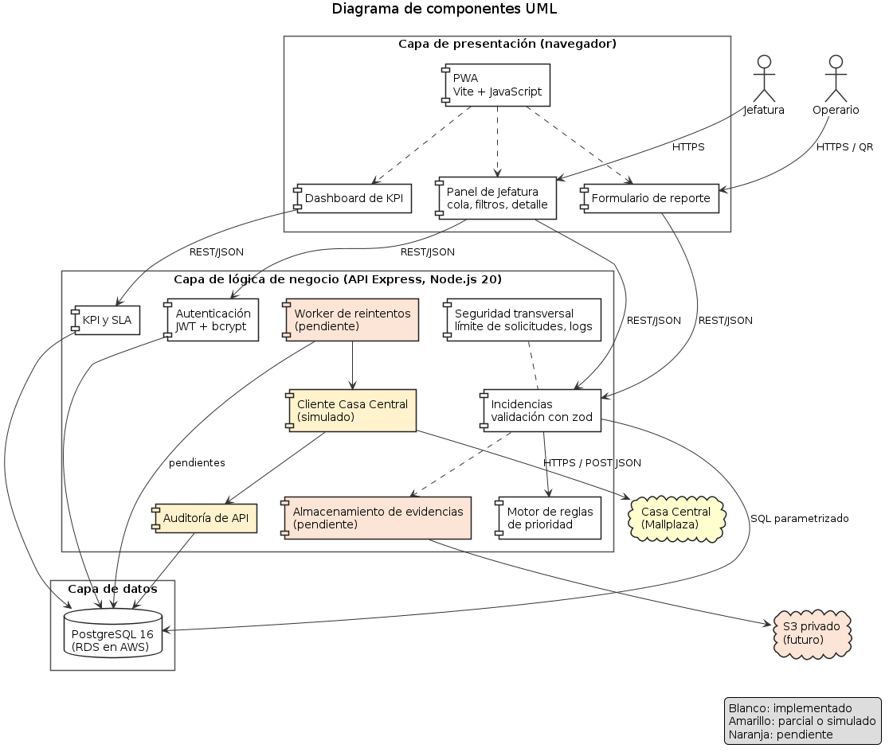

## 5. Modelo y diccionario de datos

El modelo físico del prototipo está en el esquema de la base de datos y se representa con el diagrama entidad-relación de la figura. Las relaciones de `historial_estados`, `evidencias_fotograficas` y `log_auditoria_api` con `incidencias` son uno a muchos; `usuario_id` admite nulo para el evento de creación pública, y `sla_politica` entrega el objetivo de resolución por prioridad.

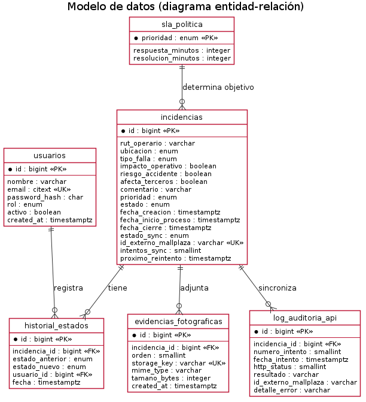

**Diccionario de datos**

**`usuarios`**

| Campo | Tipo | Regla/propósito |
|---|---|---|
| `id` | bigint identity PK | Identificador interno. |
| `nombre` | varchar(120) | Nombre visible para auditoría. |
| `email` | citext UNIQUE | Email insensible a mayúsculas; validación de formato. |
| `password_hash` | char(60) | Hash bcrypt, nunca contraseña; constraint de formato. |
| `rol` | enum `JEFATURA` | Único rol admitido actualmente. |
| `activo` | boolean | Permite invalidar acceso sin borrar historial. |
| `created_at` | timestamptz | Alta del usuario. |

: Tabla 13. Diccionario de datos: `usuarios`. Fuente: documentación del proyecto.

**`incidencias`**

| Campo | Tipo | Regla/propósito |
|---|---|---|
| `id` | bigint identity PK | ID del reporte. |
| `rut_operario` | varchar(10) | Identificador personal normalizado; módulo 11. Omitido en listados y logs. |
| `ubicacion` | enum ubicación | `ALTO_TRANSITO`, `TRANSITO_MEDIO`, `BAJO_TRANSITO`. |
| `tipo_falla` | enum tipo | Eléctrica, sanitaria/agua, estructural, estética/confort o mobiliario; no afecta prioridad. |
| `impacto_operativo` | boolean | Factor de clasificación. |
| `riesgo_accidente` | boolean | Factor de clasificación. |
| `afecta_terceros` | boolean | Factor de clasificación. |
| `comentario` | varchar(1000), nullable | Contexto libre opcional. |
| `prioridad` | enum prioridad | Resultado de función determinista. |
| `estado` | enum estado | `PENDIENTE`, `EN_PROCESO`, `RESUELTA`. |
| `fecha_creacion` | timestamptz | Inicio de medición de KPI, default DB. |
| `fecha_inicio_proceso` | timestamptz, nullable | El trigger la fija al entrar en proceso. |
| `fecha_cierre` | timestamptz, nullable | El trigger la fija al resolver. |
| `estado_sync` | enum sync | Pendiente, enviado o error de envío. |
| `id_externo_mallplaza` | varchar(64), UNIQUE, nullable | ID de orden del sistema central una vez acordado. |
| `intentos_sync` | smallint | Contador no negativo de intentos. |
| `proximo_reintento` | timestamptz, nullable | Planificación del worker futuro. |

: Tabla 14. Diccionario de datos: `incidencias`. Fuente: documentación del proyecto.

**Tablas de trazabilidad y adjuntos**

| Tabla/campo | Tipo | Regla/propósito |
|---|---|---|
| `historial_estados.id` | bigint identity PK | ID del evento. |
| `historial_estados.incidencia_id` | bigint FK | Incidencia relacionada. |
| `estado_anterior` | enum nullable | Nulo para creación; luego registra estado anterior. |
| `estado_nuevo` | enum NOT NULL | Estado alcanzado. |
| `usuario_id` | bigint FK nullable | Jefatura que hizo el cambio; nulo para reporte público. |
| `fecha` | timestamptz | Momento del evento; tabla inmutable por trigger. |
| `evidencias_fotograficas.id` | bigint identity PK | Identificador de metadato de foto. |
| `incidencia_id` | bigint FK ON DELETE CASCADE | Reporte propietario. |
| `orden` | smallint | 1..3; único por incidencia. |
| `storage_key` | varchar(255) UNIQUE | Ruta/clave de objeto, no contenido binario. |
| `mime_type` | varchar(20) | Solo JPEG, PNG o WebP. |
| `tamano_bytes` | integer | >0 y máximo 2.097.152 bytes. |
| `created_at` | timestamptz | Fecha de registro del archivo. |

: Tabla 15. Diccionario de datos: Tablas de trazabilidad y adjuntos. Fuente: documentación del proyecto.

**Tablas de integración y política**

| Tabla/campo | Tipo | Regla/propósito |
|---|---|---|
| `log_auditoria_api.id` | bigint identity PK | ID de intento de integración. |
| `incidencia_id` | bigint FK | Reporte sincronizado. |
| `numero_intento` | smallint | N° correlativo; único por incidencia junto con el ID. |
| `fecha_intento` | timestamptz | Momento del llamado. |
| `http_status` | smallint nullable | Código 100..599, nulo en error sin respuesta HTTP. |
| `resultado` | varchar(20) | `OK`, `ERROR_HTTP`, `TIMEOUT`, `ERROR_RED`. |
| `id_externo_mallplaza` | varchar(64) nullable | Identificador externo devuelto. |
| `detalle_error` | varchar(500) nullable | Descripción acotada; nunca tokens, llaves ni datos secretos. Tabla inmutable. |
| `sla_politica.prioridad` | enum PK | Una fila por prioridad. |
| `respuesta_minutos` | integer | Objetivo de primera respuesta (dato de política). |
| `resolucion_minutos` | integer | Objetivo de resolución; debe ser >= respuesta. |

: Tabla 16. Diccionario de datos: Tablas de integración y política. Fuente: documentación del proyecto.

**Valores de catálogos**

- Rol: `JEFATURA`.
- Ubicación: `ALTO_TRANSITO`, `TRANSITO_MEDIO`, `BAJO_TRANSITO`.
- Tipo: `ELECTRICA`, `SANITARIA_AGUA`, `ESTRUCTURAL`, `ESTETICA_CONFORT`, `MOBILIARIO`.
- Prioridad: `CRITICA`, `ALTA`, `MEDIA`, `BAJA`.
- Estado: `PENDIENTE`, `EN_PROCESO`, `RESUELTA`.
- Estado de integración: `PENDIENTE_SINC`, `ENVIADO`, `ERROR_ENVIO`.

## 6. Topología de comunicación, infraestructura y arquitectura TI

Los diagramas siguientes describen el entorno objetivo en AWS (región sa-east-1, la más cercana a Chile según el Informe 1) y el prototipo local. El trazo continuo indica lo incluido en el presupuesto del Informe 1 y el punteado lo propuesto u opcional. Nada de esto está desplegado.

### 6.1 Topología de comunicación

El operario y la Jefatura acceden por Internet, siempre por HTTPS, a una aplicación alojada en AWS. La aplicación es el único componente que habla con la base de datos y con Casa Central; la base de datos nunca queda expuesta a Internet.

[[LS]]

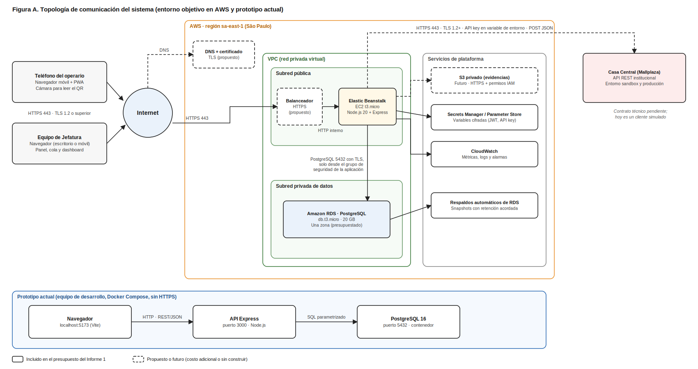

| Origen | Destino | Protocolo y puerto | Seguridad |
|------------|------------|------------|---------------------|
| Teléfono del operario y equipo de Jefatura | Aplicación en AWS | HTTPS, puerto 443 | TLS 1.2 o superior (RNF-07) |
| Elastic Beanstalk | RDS PostgreSQL | TCP 5432 con TLS | Solo desde el grupo de seguridad de la aplicación; sin acceso público |
| Elastic Beanstalk | Casa Central | HTTPS 443, POST con JSON | TLS 1.2 o superior; API key en variable de entorno cifrada (RNF-13) |
| Elastic Beanstalk | Secrets Manager, S3 y CloudWatch | HTTPS con permisos IAM | Mínimo privilegio; secretos fuera del código |

: Tabla 17. Enlaces de la topología de comunicación. Fuente: Elaboración propia.

### 6.2 Diseño de infraestructura

La configuración presupuestada es una instancia EC2 t3.micro con Elastic Beanstalk y RDS db.t3.micro de 20 GB en una sola zona, por unos USD 45 al mes (≈ $42.500 CLP). El balanceador HTTPS, el DNS, S3, la segunda zona y Multi-AZ son propuestas opcionales con costo adicional. Los grupos de seguridad propuestos son: balanceador, puerto 443 desde Internet; aplicación, solo desde el balanceador; base de datos, puerto 5432 solo desde la aplicación.

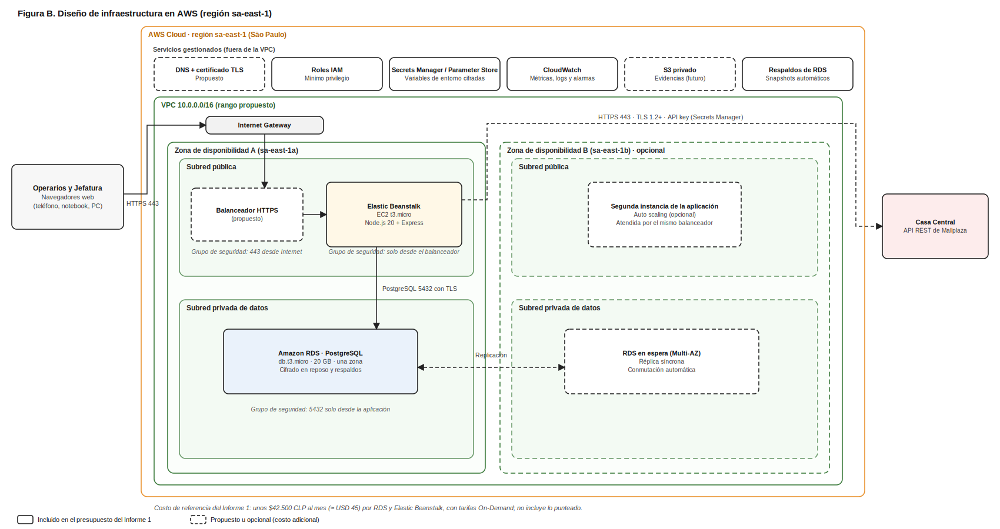

### 6.3 Arquitectura TI

La solución es una arquitectura de tres capas, cliente-servidor y monolítica, adecuada para un equipo de tres personas y 15 semanas: los microservicios agregarían complejidad de comunicación y despliegue sin beneficio. El motor de reglas es un módulo de la API, no un servicio aparte.

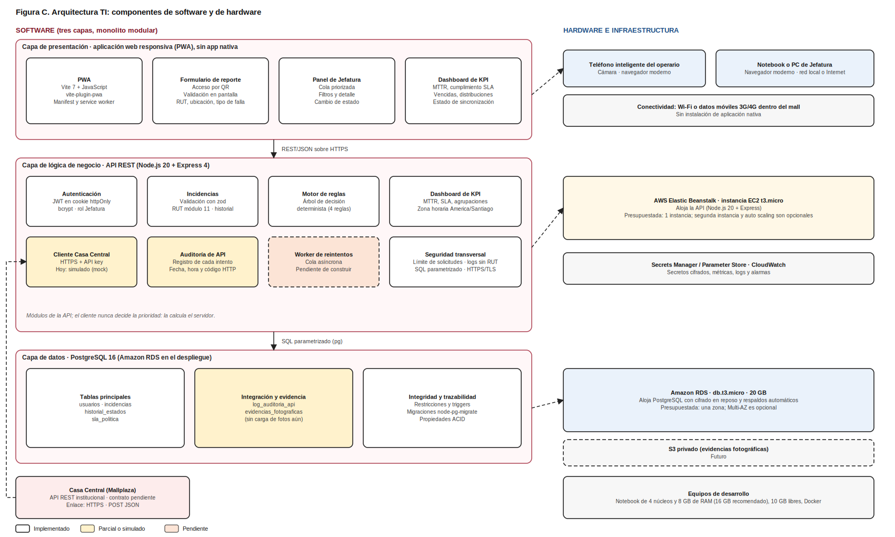

[[LE]]

[[LS]]

## 7. KPI SMART y niveles de servicio

Las metas son propuestas que requieren línea base y aprobación de la Jefatura de Mantenimiento; no son compromisos del cliente. S = específico, M = medible, A = alcanzable, R = relevante, T = temporal.

### 7.1 KPI SMART

| KPI | S | M | A | R | T | Estado |
|-------|---------|---------|-------|-------|---------|-----|
| MTTR (tiempo medio de resolución) | Tiempo promedio entre creación y cierre de las incidencias resueltas, por prioridad | Σ(cierre − creación) ÷ N° de resueltas; tabla de incidencias y dashboard | Meta escalonada sobre línea base propia | Menos tiempo con fallas abiertas | Línea base meses 1 a 3; reducir al menos 15 % al mes 6. Mensual | Implementado |
| Cumplimiento de SLA de resolución | % de incidencias resueltas dentro del plazo de su prioridad | Resueltas en plazo ÷ total de resueltas × 100 | Metas escalonadas por trimestre | Mide lo que el cliente espera | 90 % o más al mes 3 y 95 % o más al mes 6. Semanal | Implementado |
| Incidencias abiertas vencidas | Abiertas que superaron el plazo de su prioridad | Conteo con (ahora − creación) mayor al plazo | Se reduce atendiendo primero lo antiguo | Muestra el rezago accionable | Bajar el promedio semanal al menos 20 % entre los meses 1 y 3 | Implementado |
| Tiempo hasta el inicio de atención | Tiempo entre creación y paso a En proceso | Inicio de proceso − creación, contra 15, 30, 120 y 480 min | El dato ya se registra | Mide la reacción de Mantenimiento | 90 % dentro del plazo desde el mes 3 (propuesta) | Dato disponible; indicador sin implementar |
| Volumen por prioridad, tipo y ubicación | Incidencias por prioridad, tipo de falla y ubicación | Conteo en el período; dashboard | Descriptivo, sin meta al inicio | Detecta fallas recurrentes | Revisión mensual; metas tras 3 meses de datos | Implementado |
| Trazabilidad digital operativa | % de incidencias canalizadas por el sistema y no por vías informales | Registradas ÷ volumen mensual estimado × 100 | Depende de la adopción | Objetivo central del proyecto | 80 % o más al mes 3 (propuesta por validar). Mensual | No implementado |
| Disponibilidad | % del horario acordado con portal y API accesibles | Minutos disponibles ÷ minutos de servicio × 100 | Depende de la infraestructura (Anexo B, D10) | El personal debe poder reportar siempre | Mensual; 99,9 % o 99,5 % por decidir | Sin medición |
| Tiempo de respuesta del formulario | Respuesta al enviar un reporte (RNF-04) | Percentil 95 en milisegundos | Prueba local: p95 de 6 ms | Uso en terreno con 3G o 4G | p95 de 3 s o menos. Mensual | Solo medido en local |
| Tasa de error al registrar | % de envíos con error del servidor | Respuestas 5xx ÷ total de envíos × 100 | Validaciones y transacción en el servidor | Un reporte perdido es una falla sin atender | 1 % o menos. Mensual | No medido |
| Sincronización exitosa con Casa Central | % enviadas sin error y antigüedad de pendientes | Enviadas ÷ total por enviar × 100 | Depende del contrato | Garantiza la orden de trabajo formal | Umbral por acordar con TI de Mallplaza | Parcial |

: Tabla 18. KPI SMART del sistema. Fuente: Elaboración propia.

[[LE]]

### 7.2 Niveles de servicio (SLA)

Se separan dos SLA: el **operativo**, que es el resultado que espera el cliente al atender las incidencias del mall y que calcula el dashboard, y el de **plataforma**, que cubre fallas del propio software y se identifica con severidades S1 a S4 para no confundirlo con el anterior.

| Prioridad | Primera respuesta | Resolución |
|--------------------|--------------------|--------------------|
| Crítica | 15 min | 240 min (4 horas) |
| Alta | 30 min | 480 min (8 horas) |
| Media | 120 min | 1.440 min (24 horas) |
| Baja | 480 min | 4.320 min (72 horas) |

: Tabla 19. SLA operativo por prioridad de la incidencia. Fuente: Elaboración propia.

| Severidad | Ejemplo de falla del sistema | Respuesta | Resolución |
|---------|--------------------------------|---------|---------|
| S1 | Caída de la base de datos o formulario inaccesible | 15 min | 4 horas |
| S2 | El motor de reglas prioriza mal o falla la integridad de datos | 30 min | 8 horas |
| S3 | Dashboard inoperativo o error no bloqueante | 2 horas | 24 horas |
| S4 | Errores visuales que no impiden crear el reporte | 8 horas | 72 horas |

: Tabla 20. SLA de plataforma por severidad. Fuente: Elaboración propia.

| Nivel | Objetivo propuesto |
|---------------|---------------------------------------------|
| Disponibilidad | 99,9 % mensual equivale a unos 43 minutos de caída; 99,5 % a unas 3 h 36 min (decisión pendiente, Anexo B D10) |
| Formulario de reporte | Responde en 3 segundos o menos en cobertura 3G o 4G (RNF-04) |
| Tasa de error al registrar | 1 % o menos |
| Recuperación ante desastres | Pérdida máxima de datos de 15 min (RPO) y restauración en 4 h (RTO), como propuesta que requiere respaldos con recuperación a un punto en el tiempo y un simulacro |
| Marcha blanca | 15 días hábiles entre noviembre y diciembre de 2026 antes de exigir los niveles anteriores |

: Tabla 21. Niveles técnicos de servicio propuestos. Fuente: Elaboración propia.

## 8. Plan de pruebas de software

### 8.1 Estrategia y tipos de prueba

| Tipo | Casos/criterio de salida | Estado |
|---|---|---|
| Unitarias de prioridad | Tabla de verdad con las cuatro reglas, precedencia y `tipo_falla` sin efecto. | Implementado: 1 prueba de tabla con casos combinados. |
| Validación de RUT | Módulo 11, dígito K, formatos inválidos y normalización. | Implementado en API/pruebas. |
| Validación de catálogos/filtros | Enum permitido, entradas desconocidas, fechas inválidas, límites y paginación. | Implementado. |
| Migración | Aplicar schema a una DB vacía; comparar SQL migrado y `db/schema.sql`; probar down en DB desechable. | Up y equivalencia implementados/probados; rollback debe agregarse a CI. |
| Integración API + PostgreSQL | Login/logout/me; 401 genérico; alta; privacidad en lista/detalle; transición; historial; 404/409. | Implementado con Supertest y PostgreSQL local. |
| Seguridad | Rate limit, cookies, bcrypt/JWT, SQL parametrizado, secretos y RUT fuera de logs. | Cobertura básica implementada; falta análisis de seguridad externo/penetración. |
| Auditoría de Casa Central | Resultados OK/HTTP/timeout/red; número correlativo, inmutabilidad y detalle sanitizado. | Pruebas unitarias de mock/auditoría; worker real pendiente. |
| Dashboard/KPI | Fórmulas, zona horaria, cohorte de fecha, denominadores cero y filtros. | Implementado y cubierto por pruebas; revisado localmente en navegador con datos sintéticos. No reemplaza validación de metas con Jefatura. |
| Fotos | 0–3 archivos, tamaño 2 MB, MIME, nombres seguros, S3 privado, URL y autorización. | Pendiente; restricciones están parcialmente en esquema. |
| PWA/usabilidad | Formulario de reporte JSON, login Jefatura, cola, filtros, detalle e historial en navegador móvil/escritorio; QR en Android/iOS, cámara, teclado, accesibilidad, errores y reintento de red. | Recorrido local de los flujos principales completado en navegador con datos sintéticos. QR gráfico, fotos, pruebas amplias de accesibilidad/dispositivos y manejo offline siguen pendientes. |
| Rendimiento/carga | Pico estimado, p95, pool, conexión RDS y límites. | Pendiente de volumen acordado y ambiente parecido a producción. |
| Resiliencia/DR | Caída de AZ/DB, restauración, DNS/deploy rollback, RTO/RPO demostrados. | Pendiente de infraestructura y simulacro. |
| Aceptación usuario | Operario reporta en menos de objetivo acordado; Jefatura gestiona cola y KPI; cliente firma UAT. | Aceptación visual técnica local del recorrido principal completada; no hubo UAT con Mallplaza ni firma de cliente, y no hay meta de tiempo validada. |

: Tabla 22. Tipos de prueba:. Fuente: documentación del proyecto.

La estrategia de ejecución es: ejecutar lint y pruebas en cada entrega; usar una base PostgreSQL desechable para migraciones e integración, sin datos productivos; correr las pruebas en integración continua en cada cambio; hacer la aceptación con usuarios con datos ficticios, y bloquear una liberación si falla una regla crítica, aparece el RUT o un secreto en los registros, o se pierde trazabilidad.

### 8.2 Resultados de ejecución

El 10 de octubre de 2026 pasó completa la suite automatizada del repositorio (33 pruebas en 9 archivos) y se ejecutaron 46 casos contra el backend en un entorno local (Node 22, PostgreSQL 16, base limpia, por HTTP): 45 aprobados y 1 hallazgo de seguridad. Quedan 10 casos manuales (celular real, QR, aceptación con la Jefatura) y 8 casos bloqueados por funcionalidad aún no construida (fotos, Casa Central real, HTTPS y AWS).

| ID | Caso | RF o RNF | Resultado obtenido | Estado |
|----|-------------------|---------|-------------------|-------|
| TC-01 | Inicio de sesión con credenciales válidas | RF-01, RNF-06 | HTTP 200 · cookie recibida | Aprobado |
| TC-02 | Contraseña incorrecta | RF-01 | HTTP 401 · INVALID_CREDENTIALS · «Credenciales inválidas» | Aprobado |
| TC-03 | Correo inexistente: mensaje idéntico al de contraseña incorrecta | RF-01 | HTTP 401 · INVALID_CREDENTIALS · «Credenciales inválidas» | Aprobado |
| TC-04 | Cola sin sesión | RF-02, RNF-05 | HTTP 401 · UNAUTHORIZED | Aprobado |
| TC-05 | Dashboard sin sesión | RF-02, RNF-05 | HTTP 401 · UNAUTHORIZED | Aprobado |
| TC-06 | Cierre de sesión | RF-03 | HTTP 204 (sin contenido) · cookie invalidada | Aprobado |
| TC-07 | Alta válida de incidencia | RF-04 a RF-11, RF-14, RF-15, RF-18 | HTTP 201 · id 1 · prioridad CRITICA · estado PENDIENTE | Aprobado |
| TC-08 | Alta sin RUT | RF-06, RF-14 | HTTP 400 · VALIDATION_ERROR | Aprobado |
| TC-09 | RUT con dígito verificador inválido (módulo 11) | RNF-12 | HTTP 400 · VALIDATION_ERROR | Aprobado |
| TC-10 | Alta sin el campo obligatorio de impacto operativo | RF-08, RF-14 | HTTP 400 · VALIDATION_ERROR | Aprobado |
| TC-11 | Tipo de falla fuera del catálogo | RF-07 | HTTP 400 · VALIDATION_ERROR | Aprobado |
| TC-12 | Ubicación fuera del catálogo | RF-05 | HTTP 400 · VALIDATION_ERROR | Aprobado |
| TC-13 | Alta sin comentario (campo opcional) | RF-11 | HTTP 201 · prioridad BAJA | Aprobado |
| TC-14 | La respuesta del alta no devuelve el RUT | RNF-10 | El cuerpo no contiene el RUT | Aprobado |
| TC-15 | Prioridad: Alto tránsito + impacto operativo | RF-16, RF-17 | HTTP 201 · prioridad CRITICA | Aprobado |
| TC-16 | Prioridad: Bajo tránsito + riesgo de accidente | RF-16, RF-17 | HTTP 201 · prioridad ALTA | Aprobado |
| TC-17 | Prioridad: Bajo tránsito + afecta a terceros | RF-16, RF-17 | HTTP 201 · prioridad ALTA | Aprobado |
| TC-18 | Prioridad: Alto tránsito sin otros factores | RF-16, RF-17 | HTTP 201 · prioridad MEDIA | Aprobado |
| TC-19 | Prioridad: Bajo tránsito + impacto operativo | RF-16, RF-17 | HTTP 201 · prioridad MEDIA | Aprobado |
| TC-20 | Prioridad: Bajo tránsito sin factores | RF-16, RF-17 | HTTP 201 · prioridad BAJA | Aprobado |
| TC-21 | Prioridad: Precedencia: alto tránsito + impacto + riesgo + terceros | RF-16, RF-17 | HTTP 201 · prioridad CRITICA | Aprobado |
| TC-22 | Determinismo: el mismo reporte da la misma prioridad | RF-16 | Prioridades: ALTA y ALTA | Aprobado |
| TC-23 | Cola ordenada por prioridad (Crítica a Baja) | RF-33 | HTTP 200 · 11 filas · orden correcto | Aprobado |
| TC-24 | La lista no expone el RUT | RNF-10 | La lista no contiene el RUT | Aprobado |
| TC-25 | El detalle sí muestra el RUT a Jefatura autenticada | RF-22, RNF-10 | HTTP 200 · RUT presente | Aprobado |
| TC-26 | Filtro por prioridad | RF-24 | HTTP 200 · 3 resultados | Aprobado |
| TC-27 | Filtro por tipo de falla | RF-26 | HTTP 200 · 11 resultados | Aprobado |
| TC-28 | Filtro por ubicación | RF-25 | HTTP 200 · 5 resultados | Aprobado |
| TC-29 | Filtro por estado | RF-23 | HTTP 200 · 11 resultados | Aprobado |
| TC-30 | Búsqueda por número de incidencia | RF-27 | HTTP 200 · 1 resultado(s) | Aprobado |
| TC-31 | Búsqueda con identificador no numérico | RF-27 | HTTP 400 · VALIDATION_ERROR | Aprobado |
| TC-32 | Filtro con valor inválido | RF-24 | HTTP 400 · VALIDATION_ERROR | Aprobado |
| TC-33 | No se puede resolver sin pasar por En proceso | RF-21 | HTTP 409 · INVALID_TRANSITION | Aprobado |
| TC-34 | Pasar de Pendiente a En proceso | RF-19 | HTTP 200 | Aprobado |
| TC-35 | Resolver una incidencia En proceso y registrar la fecha de cierre | RF-20 | HTTP 200 · fecha_cierre registrada | Aprobado |
| TC-36 | No se puede retroceder una incidencia Resuelta | RF-19, RF-21 | HTTP 409 · INVALID_TRANSITION | Aprobado |
| TC-37 | Historial con ambos cambios de estado | RF-22 | 3 entradas: null→PENDIENTE, PENDIENTE→EN_PROCESO, EN_PROCESO→RESUELTA | Aprobado |
| TC-38 | El alta deja la sincronización pendiente y no espera a Casa Central | RF-40, RNF-14 | Detalle contiene PENDIENTE_SINC: true | Aprobado |
| TC-39 | KPI con datos: MTTR, SLA y agrupaciones | RF-28 a RF-31, RF-40 | HTTP 200 · faltantes: ninguno | Aprobado |
| TC-40 | MTTR numérico tras resolver una incidencia | RF-28 | mttr_minutos = 0 | Aprobado |
| TC-41 | Filtro por rango de fechas (el día de hoy) | RF-32 | HTTP 200 · incidencias por prioridad: {"ALTA":4,"BAJA":2,"MEDIA":2,"CRITICA":3} | Aprobado |
| TC-42 | Rango inválido (fecha inicial posterior a la final) | RF-32 | HTTP 400 · VALIDATION_ERROR | Aprobado |
| TC-43 | Verificación de salud sin consultar la base | — | HTTP 200 | Aprobado |
| TC-44 | Tiempo de respuesta del alta (30 envíos seguidos, entorno local) | RNF-04 | p50 3 ms · p95 6 ms · máx 6 ms | Aprobado |
| TC-45 | 20 envíos simultáneos sin pérdidas ni duplicados (entorno local) | RNF-09, RNF-08 | 20 con HTTP 201 · 20 identificadores distintos · máx 143 ms | Aprobado |
| TC-46 | Reutilizar la cookie anterior después de cerrar sesión | RF-03, RNF-05 | HTTP 200 | Observación |

: Tabla 23. Casos de prueba ejecutados contra el backend (10 de octubre de 2026). Fuente: Elaboración propia.

El hallazgo **TC-46** indica que la cookie de sesión copiada antes de cerrar sesión sigue siendo válida hasta que expira (8 horas), porque el token no se revoca en el servidor. El requisito RF-03 se cumple en el navegador, pero conviene acortar la vigencia o agregar revocación. La medición de rendimiento (p95 de 6 ms en 30 envíos y 20 envíos simultáneos sin errores) es una referencia local y no reemplaza una prueba de carga en un entorno parecido a producción.

## 9. Normas y estándares aplicados

La mención de una norma no implica auditoría ni conformidad certificada. Antes de la entrega conviene citar la edición exacta y la fecha de consulta en la bibliografía y validar con el docente cuáles espera el curso. Además, el documento de definición arquitectónica menciona ISO 14001 (ambiental) e ISO 45001 (seguridad) como respaldo normativo de la bitácora; esas normas no figuran en la tabla y hay que decidir si se incluyen y con qué argumento.

| Norma/guía | Aplicación y justificación | Estado |
|---|---|---|
| Ley Chile 21.719 / protección de datos personales | El RUT es dato personal. Definir finalidad, base de tratamiento, transparencia, minimización, acceso, retención, seguridad y ejercicio de derechos con el responsable legal. La BCN indica entrada en vigencia el 01-dic-2026; el proyecto debe diseñarse para cumplirla desde el lanzamiento y revisar el texto vigente con asesoría institucional. | Principios técnicos incorporados parcialmente; evaluación legal, aviso y retención pendientes. |
| OWASP Top 10 y OWASP ASVS (verificar edición vigente al congelar diseño) | Guían validación, autenticación, control de acceso, manejo de errores, configuración, sesiones, integridad de datos y pruebas de seguridad. No reemplazan pentest ni certifican por sí solas. | Mitigaciones iniciales; checklist de verificación pendiente. |
| ISO/IEC 27001/27002 (sistema y controles de seguridad) | Marco para riesgos, acceso, activos, incidentes, proveedores, continuidad y control de cambios. Se usa como referencia de control, no se afirma certificación. | Controles de código básicos; SGSI/certificación fuera del alcance académico inicial. |
| ISO/IEC 25010 (calidad del producto) | Estructura requisitos no funcionales en seguridad, confiabilidad, rendimiento, mantenibilidad, compatibilidad/usabilidad. Facilita convertir adjetivos en KPI/SLO verificables. | Criterios propuestos; baseline de rendimiento y usabilidad pendientes. |
| TLS 1.2 o superior | Protege datos en tránsito entre móvil, API, RDS e integración. HTTPS obligatorio en diseño productivo. | No existe despliegue productivo que validar. |
| OWASP API Security | Complementa controles de autorización por objeto, autenticación, consumo de recursos, configuración y exposición de datos en endpoints. | Rate limit, validación y autorización Jefatura parcial; revisar todos los endpoints previo a producción. |
| Accesibilidad WCAG 2.2 AA (objetivo de interfaz) | Formulario QR debe ser operable con teclado/lector, etiquetas/contraste y mensajes entendibles. Es relevante para operarios con dispositivos diversos. | PWA local implementada; auditoría formal y pruebas con tecnologías de asistencia pendientes. |
| Convención Conventional Commits / PR | Hace cambios auditables y facilita revisión grupal y rollback. | Aplicada en los commits del repositorio compartido; aún sin pull requests. |

: Tabla 24. Normas y estándares:. Fuente: documentación del proyecto.

## Anexo A. Resumen de cumplimiento de requerimientos

El detalle por requerimiento, con su componente, prueba y observación, está en la matriz de trazabilidad (planilla que acompaña al capítulo).

| Estado | RF | RNF |
|---------------------------------|-------------|-------------|
| Implementado y probado | 29 | 3 |
| Implementado | 2 | 2 |
| Parcial | 5 | 4 |
| Mock | 1 | 0 |
| Pendiente | 3 | 3 |
| Diseñado (no desplegado) | 0 | 2 |
| **Total** | 40 | 14 |

: Tabla 25. Estado de los requerimientos funcionales (40) y no funcionales (14). Fuente: Elaboración propia.

## Anexo B. Decisiones y discrepancias por resolver

| ID | Tema | Acción sugerida |
|----|-----------------|--------------------------------------|
| D1 | Cantidad de requisitos | Actualizar el capítulo de requisitos y la tabla MoSCoW del informe. |
| D2 | Quién usa el QR | Decidir con el cliente y dejar una sola redacción. Si el QR es de uso interno, definir cómo se protege (código por operario, acceso solo en la red del mall, etc.). |
| D3 | QR por sector frente a RF-05 | Mantener RF-04/05 tal como están. Si se quiere QR por sector, registrarlo como RF nuevo o como mejora futura. Aun así sirve la tabla de zonas: cada zona lleva su nivel de tránsito. |
| D4 | Zonas frente a niveles de tránsito | Preguntarle a Mauricio Maldonado cuál de las dos lecturas quiere. Mientras tanto, RF-05 se considera cumplido con la definición del Informe 1. |
| D5 | Fotos: opcional y mínimo 1 | Interpretar como 0 fotos o entre 1 y 3, y confirmarlo con el cliente. |
| D6 | RUT sin validación cruzada y módulo 11 | Aclarar en el informe: se valida formato, no existencia. |
| D7 | Fecha de cierre | Confirmar qué se entrega el 14-oct y qué en diciembre; ajustar el plan y el discurso de la demo. |
| D8 | Requisitos de infraestructura en un prototipo local | Presentarlos como 'diseñado, se verifica al desplegar' y explicar el plan de despliegue. |
| D9 | Base de datos en el presupuesto | Corregir el Informe 1 a PostgreSQL y cotizar RDS PostgreSQL db.t3.micro con la calculadora de AWS. |
| D10 | Disponibilidad frente a lo presupuestado | Bajar el objetivo (por ejemplo al 99,5 % que plantea el repositorio) o presupuestar la alta disponibilidad. |
| D11 | Balanceador y DNS fuera del presupuesto | Decidir cuál de las dos opciones se adopta y reflejarla en la figura de infraestructura y en el presupuesto. |
| D12 | Dos presupuestos distintos | Reconciliar ambos montos y usar una sola cifra en el informe final. La hoja 'Factibilidad económica' calcula con las dos. |

: Tabla 26. Conflictos entre documentos y acción sugerida. Fuente: Elaboración propia.
