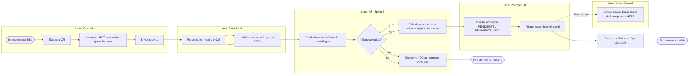
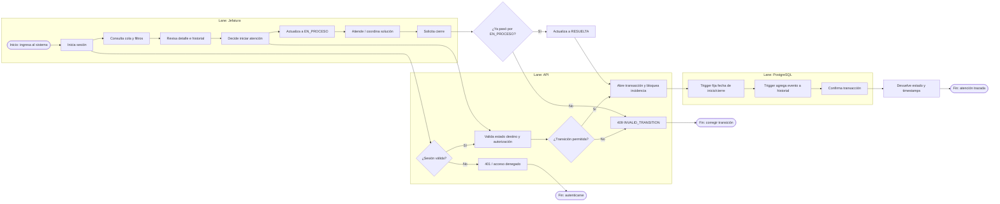
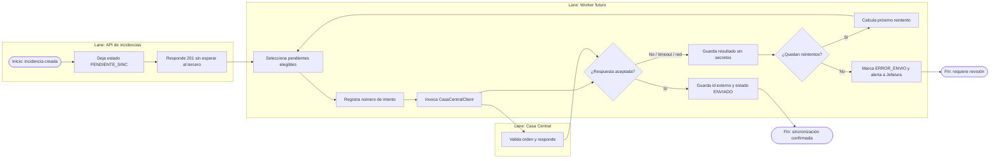
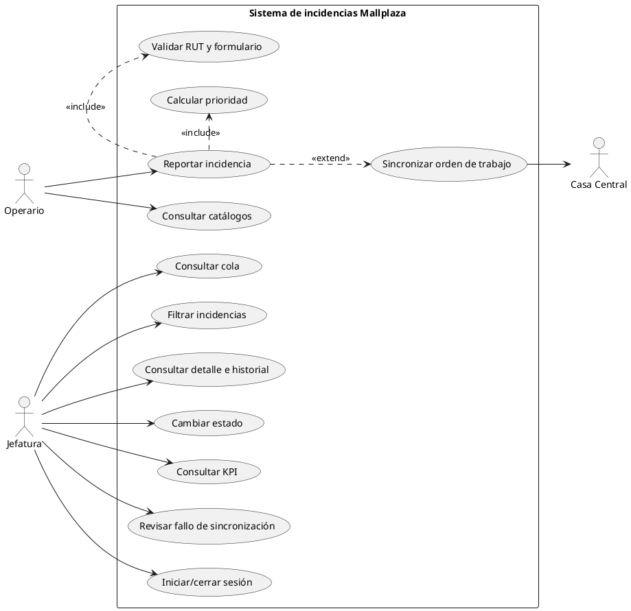
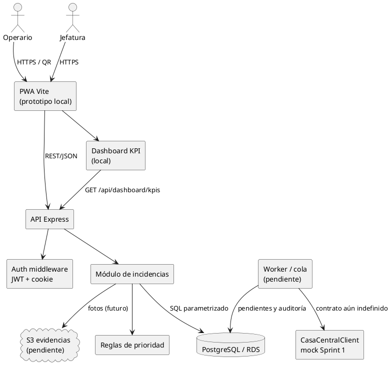
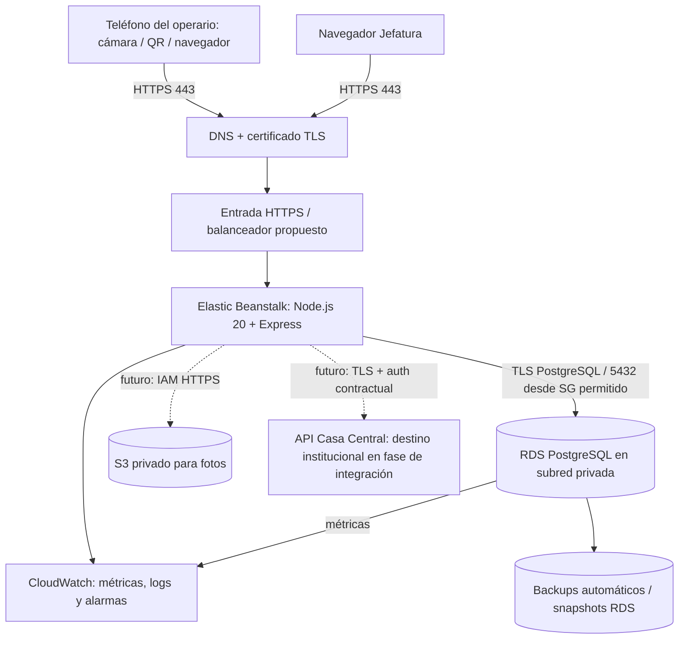
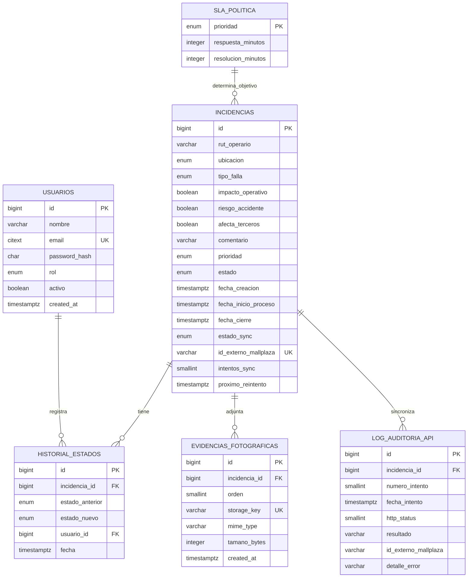

# Informe de diseño, desarrollo y planificación

## Sistema de Gestión y Trazabilidad de Incidencias — Mallplaza Copiapó

**Versión:** 2.0 — 9 de octubre de 2026
**Fecha objetivo de entrega académica:** 14 de octubre de 2026  
**Estado:** informe vivo; se actualizará en cada avance relevante.  
**Alcance de esta versión:** prototipo local con backend, PWA, KPI, generador QR de demostración y arranque integrado de PostgreSQL/API/frontend con Docker Compose; recorrido visual de punta a punta con datos sintéticos. Producción AWS, carga de fotografías e integración real externa continúan pendientes.

## Resumen ejecutivo

El proyecto propone un sistema web para reportar fallas operativas mediante QR, calcular su prioridad con reglas deterministas y permitir a Jefatura gestionar su ciclo de vida. La persistencia se diseña en PostgreSQL y la interoperabilidad con la plataforma central se modela mediante un adaptador independiente, sustituible por el conector institucional en la fase de integración.

Al 9 de octubre está implementada la base de backend y se incorporó una interfaz web/PWA que consume las rutas existentes para reportar y gestionar incidencias. También se agregó un endpoint autenticado para calcular KPI desde PostgreSQL. El build PWA, lint y la suite de 27 pruebas pasan en Ubuntu/WSL. Además, se completó en navegador el recorrido local de alta, consulta y resolución de un caso sintético; estas pruebas no son datos operacionales ni una aceptación de Mallplaza.

La meta propuesta para el 14 es cerrar un **prototipo local demostrable**: formulario web móvil, gestión de incidencias por Jefatura, indicadores principales, persistencia Docker y simulación local de Casa Central. No se incorporan fotos en el build de entrega mientras falten carga segura, política de retención y validación. La publicación en AWS y la conexión efectiva a la plataforma central corresponden a fases posteriores.

## 1. Cómo se gobierna el alcance: lo fijo y lo adaptable

Para evitar que cada integrante cambie una regla sin advertirlo, este informe distingue tres categorías:

| Categoría | Significado | Regla de gestión |
|---|---|---|
| **Fijo — requisito del proyecto** | Regla de negocio o restricción establecida en las instrucciones vigentes del proyecto. | No cambiar por conveniencia técnica. Si se solicita modificarla, registrar motivo, impacto, aprobación y actualizar pruebas/documentación en el mismo cambio. Esta categoría no implica aprobación corporativa. |
| **Línea base — ya implementado** | Comportamiento actual del prototipo/API. | Se conserva para evitar regresiones; puede evolucionar mediante tarea, revisión y pruebas. No equivale a requisito inmutable si el dueño del proyecto lo reabre. |
| **Adaptable — diseño/propuesta** | UI, diseño visual, metas, arquitectura productiva y parámetros sin decisión contractual. | Ajustar según pruebas con usuarios, avances y restricciones reales; anotar fecha, motivo, decisión y efecto en cronograma. |
| **Fase de integración/validación** | Parámetros que se incorporarán al conectar servicios institucionales y cerrar aceptación operativa. | Mantener adaptadores y metas parametrizables; no presentar configuraciones de prototipo como productivas. |

### 1.1 Fijo — no se cambia sin aprobación expresa

1. **Stack objetivo:** Node.js 20, Express, `pg` sin ORM, Zod, bcrypt cost 12, JWT, Multer para la etapa de fotos, Pino, PostgreSQL 15+, node-pg-migrate, Vite/PWA y Chart.js; despliegue objetivo Elastic Beanstalk + RDS + S3. El prototipo puede usar un adaptador local, pero no reemplaza esos destinos.
2. **Prioridad y precedencia:** primera regla que coincide: impacto operativo + alto tránsito → Crítica; riesgo o terceros → Alta; alto tránsito o impacto → Media; si nada de lo anterior → Baja. `tipo_falla` se almacena, no influye en prioridad.
3. **Estados:** solo `PENDIENTE → EN_PROCESO → RESUELTA`; no se puede resolver sin pasar por En proceso. El trigger de DB es barrera de integridad; la API traduce conflicto a HTTP 409.
4. **Campos obligatorios y validación:** RUT módulo 11, catálogos establecidos, tres factores booleanos; comentario opcional hasta 1000 caracteres. Fotos definidas como 0–3, JPEG/PNG/WebP, máximo 2 MB cada una cuando se implemente carga.
5. **KPI/SLA de negocio:** MTTR sobre resueltas y fecha de creación; cumplimiento SLA de resolución; abiertas vencidas; conteos por prioridad/tipo/ubicación/estado de sync. Umbrales de resolución por prioridad definidos en la política del prototipo.
6. **Privacidad y seguridad:** SQL parametrizado, validación de entradas, rate limit, no poner RUT/secretos/tokens en logs, sesión Jefatura protegida y HTTPS/TLS en producción.
7. **Integración central:** el alta no debe esperar a otro sistema. El mock del prototipo no se presenta como conexión efectiva; el conector final se configurará para la interfaz institucional de la fase de integración.

Estos puntos se consideran cerrados en el prototipo, salvo que el dueño del requisito solicite formalmente modificarlos. “Fijo” significa estable para el trabajo grupal, no imposible de cambiar por una decisión del cliente; significa que un cambio requiere trazabilidad.

### 1.2 Línea base actual — proteger contra regresiones

- API backend funciona como servicio JSON y usa respuestas de error normalizadas.
- Login Jefatura con bcrypt/JWT en cookie `httpOnly`, `SameSite=Strict`, duración 8 h y `Secure` en producción.
- Alta pública calcula prioridad y deja `estado_sync = PENDIENTE_SINC`; el endpoint responde sin esperar Casa Central.
- Jefatura lista/filtra incidencias, ve detalle/historial y avanza estados.
- El panel de Jefatura refresca automáticamente cola, KPI y detalle abierto cada 10 segundos mientras la pestaña está visible; las transiciones realizadas desde el mismo panel siguen actualizando los datos inmediatamente.
- El frontend PWA incluye formulario de reporte JSON, login de Jefatura, cola, filtros, detalle e historial. El formulario no carga fotos.
- Se agregó `GET /api/dashboard/kpis` con filtro por período, MTTR, cumplimiento SLA, abiertas vencidas y conteos categorizados; pruebas y recorrido visual local aprobaron su uso en el prototipo.
- El RUT no aparece en lista ni respuesta pública; el detalle autenticado sí lo incluye bajo el contrato actual y requiere validar necesidad/retención.
- PostgreSQL local corre por Docker Compose; la migración replica el modelo inicial del prototipo en `db/schema.sql`.
- PostgreSQL, API y frontend de desarrollo se pueden levantar juntos con `docker compose up --build`; Compose espera la salud de la base, aplica migraciones y crea el usuario ficticio de Jefatura antes de iniciar Vite.
- El modelo de datos está explicado y sujeto a revisión técnica/académica; no se afirma que sea una especificación entregada o aprobada por Mallplaza.
- Lint y 33 pruebas de backend pasaron. El build PWA y flujos KPI/alta se verificaron localmente con datos sintéticos; el 9 de octubre se completó la prueba visual de punta a punta del caso #2 (commit `61b48e4`). bcrypt 6.0.0, Vitest 4.1.11 y node-pg-migrate 8.0.4 pasaron en Node 20.20.2; `npm audit` completo informa cero vulnerabilidades. La actualización de dependencias está en el commit `8c8fdab`.

Si el frontend necesita cambiar contratos, primero actualizamos `docs/api.md`, definimos compatibilidad, sumamos pruebas y recién después modificamos consumidores/servidor.

### 1.3 Adaptable — se puede ir corrigiendo por evidencia

- Diseño visual, navegación, textos y accesibilidad de PWA; QR físicos y contenido de cada QR.
- Maquetación de dashboard y forma de representar KPI, una vez se validen fórmulas con Jefatura.
- Objetivos SMART provisionales, horario de servicio, umbrales de respuesta y resolución que no estén fijados por tabla de negocio.
- Metas TI propuestas (99,5% disponibilidad, p95, RTO/RPO), región/tamaño/costo AWS, retención de logs/backups/fotos.
- Forma de persistir imágenes localmente en el prototipo, siempre detrás de un servicio que luego pueda cambiar a S3.
- Herramienta y exportación final de BPMN/UML y formato de bibliografía que exija el curso.
- Orden y duración de fases según avance real, disponibilidad de equipo e hitos de validación.

Cada ajuste se documenta con: `fecha`, `decisión`, `razón/evidencia`, `impacto en arquitectura/datos`, `impacto en pruebas`, `impacto en fecha`, `responsable` y `aprobador`.

### 1.4 Pendiente externo — no asumir como listo

- Casa Central: URL, autenticación, payload, sandbox, idempotencia, límites, errores y política de reintentos.
- Cliente/operaciones: flujo de asignación real, horarios, definición de primera respuesta, prioridades de negocio y aceptación UAT.
- Responsable de datos: necesidad del RUT, aviso/retención, acceso y derechos aplicables.
- AWS/organización: cuenta, región, presupuesto, dominio, redes, roles IAM, monitoreo y responsables de operación.
- Equipo académico: repo Git compartido, rama base, fecha/hora exacta de cierre y formato de entrega.

## 2. Objetivo y alcance del prototipo

### Objetivo general

Disminuir el tiempo entre detectar y gestionar una falla operativa, dando a Jefatura trazabilidad de prioridad, estado, tiempos y tipo/ubicación del incidente.

### Alcance propuesto al 14 de octubre

**Incluido en el objetivo de prototipo local:** formulario PWA usable desde navegador móvil, login de Jefatura, alta y priorización, lista/filtros/detalle, avance de estados, dashboard con KPI, PostgreSQL local y modo mock de integración. La carga de fotos y un QR gráfico se difieren; no se habilitarán adjuntos sin validación segura y política de retención.

**Fuera del objetivo del 14:** producción AWS, disponibilidad/DR garantizados, integración Casa Central real, monitoreo productivo, certificación de normas, operación 24/7 y datos reales de operarios. Ninguna de estas capacidades se declara terminada por tener un diagrama o columna en el esquema.

### Criterios de aceptación para decir “prototipo local terminado”

1. Operario abre el formulario desde enlace/QR de demostración y registra una incidencia válida; ve confirmación sin RUT.
2. Reglas de prioridad concuerdan con la tabla de verdad y quedan explicables en la interfaz/documentación.
3. Jefatura inicia sesión, filtra cola, ve detalle/historial y hace transiciones permitidas; las inválidas responden 409.
4. Dashboard presenta MTTR, cumplimiento SLA y abiertas vencidas con fórmula y rango temporal visibles; estos KPI están implementados y probados localmente.
5. La demo se levanta con instrucciones reproducibles en Docker/local, usa datos ficticios y no necesita cuenta AWS.
6. Lint y pruebas automatizadas pasan; la guía de operación/demostración describe arranque, usuario semilla y reinicio de datos.
7. La integración externa se identifica como mock y no duplica ni aparenta crear órdenes reales.

### 2.1 Matriz de cierre de los entregables académicos

La tabla separa entregables documentales del prototipo ejecutable. Un diagrama de una infraestructura futura no prueba que esté desplegada; una propuesta de estándar no prueba certificación ni conformidad legal.

| Entregable solicitado | Estado actual | Evidencia o brecha para el cierre |
|---|---|---|
| Comparación cualitativa/cuantitativa de tecnologías | Documentado como análisis del equipo | `docs/seleccion-tecnologias.md`; ponderaciones son valoración académica, no benchmark. |
| Herramientas, lenguajes, hardware y servicios TI | Documentado; entorno local definido | Stack y requisitos en selección tecnológica y ejecución local. Dimensionamiento AWS/costo siguen por acordar. |
| Tres procesos BPMN con subprocesos | Documentados como flujos Mermaid compatibles conceptualmente | En `docs/procesos-y-arquitectura.md`; convertir a BPMN 2.0 editable si la pauta exige notación formal. |
| UML de casos de uso y componentes | Documentado en PlantUML | Distingue prototipo local y componentes pendientes. Renderizar/exportar figuras finales si la entrega requiere imágenes. |
| Modelo de datos y diccionario | Documentado | `db/schema.sql`, `docs/datos-kpi-sla.md` y justificación; esquema es propuesta inicial con asistencia de IA, no aprobado por Mallplaza. |
| Topología de comunicación e infraestructura | Documentado como diseño objetivo | El diagrama de AWS es una propuesta; no hay VPC/EB/RDS/S3 productivos desplegados. |
| Arquitectura con infraestructura software/hardware | Documentado como arquitectura lógica y objetivo | Implementado local: navegador/PWA, Express y PostgreSQL Docker; producción depende de accesos, costo, DNS e IAM. |
| KPI SMART y SLA | Fórmulas/KPIs implementados; metas SMART y SLA TI son propuestas | KPI locales probados. Objetivos operacionales requieren baseline, horario y validación de Jefatura/cliente. |
| Plan de pruebas | Diseñado y pruebas backend ejecutadas | 33 pruebas, lint y build reportados en verde; faltan accesibilidad/dispositivos, carga, pentest, concurrencia intensiva y DR. |
| Normas y estándares | Referencias y motivos documentados | No implica certificación ni dictamen legal. Confirmar versiones/citas exigidas por docente y actualizar análisis normativo antes de producción. |
| Servicios TI y disponibilidad | Catálogo y metas propuestos | No existen SLO/SLA productivos, guardia, monitoreo ni redundancia activos. |
| Continuidad proactiva/reactiva | Procedimientos documentados | RTO/RPO propuestos; respaldos y restauración no se han demostrado en AWS. |
| Control de cambios e incidentes | Procedimiento documentado | La colaboración requiere repositorio remoto común, responsables y revisión efectiva del equipo. |
| Planificación Gantt/fases y adecuación | Fases adaptativas documentadas | Actualizar fechas/horas con integrantes y fecha de entrega confirmada; no se presentan duraciones como compromisos del cliente. |
| Prototipo local ejecutable | Implementado y recorrido visualmente | Reutilizar el caso ficticio #2; build, pruebas y lint reportados en verde. Revisar instrucciones de arranque en equipo de exposición. |
| QR gráfico y carga de fotos | Pendiente | El acceso puede compartirse como URL local; no hay QR generado ni endpoint multipart. |
| Integración Casa Central real | Bloqueada por contrato técnico externo | No inventar payload, credenciales ni respuesta; mock deja `PENDIENTE_SINC`. |
| Producción AWS | Fuera del alcance local inmediato | Requiere cuenta, aprobación, presupuesto, red, secretos, dominio, responsables y estrategia de operación. |

### 2.2 Qué significa completar el porcentaje pendiente

El trabajo restante no equivale a implementar en pocos días todos los servicios productivos. Para la entrega académica, el cierre realista es completar la documentación consolidada, verificar reproducibilidad local, ensayar el recorrido principal y presentar brechas con responsable y dependencia. QR gráfico y fotos quedan fuera del cierre local actual; AWS y Casa Central real deben planificarse cuando existan accesos y contrato. Por eso, este informe no asigna “100 %” al sistema productivo: describe un prototipo local funcional y una arquitectura objetivo parcialmente pendiente.

## 3. Plan corto hasta el 14 de octubre

La estimación toma como fecha actual el 9 de octubre y el cierre académico el 14. Es una planificación de prototipo enfocado, no una promesa de producto productivo. Requiere mantener el alcance; con cambios de cliente o accesos nuevos, reestimaremos y priorizaremos el flujo demostrable.

| Fecha | Tarea pequeña | Entregable y condición de cierre | Riesgo |
|---|---|---|---|
| 9 oct | Alinear línea base, consolidar informe, preparar ejecución local y revisar brechas. | API, PWA y KPI están implementados; lint, 27 pruebas, build y aceptación visual reportados. |
| 10 oct | Corregir documentación obsoleta, verificar arranque reproducible en el equipo de exposición y crear paquete DOCX consolidado. | Informe coherente con código, guía actualizada y artefacto Word renderizado/revisado. |
| 11 oct | Ensayar flujo con incidencia sintética existente, revisar logout con herramientas de navegador si el entorno está disponible. | Ensayo sin alterar registros compartidos; defectos y límites anotados. |
| 12 oct | Revisión cruzada del grupo/docente; priorizar observaciones críticas y decidir explícitamente si QR/fotos se aceptan como trabajo posterior. | Decisiones registradas, criterios de aceptación y pendientes responsables. |
| 13 oct | Congelar release local, repetir lint/tests/build, verificar instrucciones y corregir defectos críticos de documentación/demo. | Release candidate reproducible y documentación consistente. |
| 14 oct | Entrega y exposición. | Presentar prototipo y distinguir claramente propuesta, implementación y dependencias externas. |

**Estimación actualizada al 9 de octubre:** el núcleo local y su aceptación visual ya están demostrados. El cierre restante para la entrega académica se estima en **1–2 jornadas enfocadas** para revisar el entorno del equipo, ensayar la demo, completar revisión grupal, renderizar/revisar el informe Word y congelar la entrega. QR gráfico y fotos serían incrementos separados de aproximadamente **2–4 jornadas** incluyendo diseño, implementación y pruebas; se difieren si amenazan estabilidad. Una solución productiva con S3, AWS, integración contractual, HA/DR probados y operación segura requiere varias semanas y dependencias externas; no forma parte de la estimación de prototipo local.

### Orden y prioridad si aparece atraso

1. **P0:** levantamiento reproducible, alta pública, prioridad, login, cola, detalle y transición.
2. **P1:** KPI y pruebas de aceptación; requisito fuerte de la exposición y del problema de negocio.
3. **P2:** diseño PWA/QR, accesibilidad y manejo de mensajes.
4. **P3:** QR gráfico/fotos; diferir para no distraer de P0/P1 y completar validación de privacidad/seguridad antes de adjuntos.
5. **P4:** mock de reintentos demostrativos; no fabricar integración real.

## 4. Cómo trabajaremos en tareas pequeñas

Cada tarea tendrá: objetivo, fuera de alcance, archivos esperados, criterios de aceptación, pruebas y actualización documental. No mezclaremos migraciones de esquema con retoques visuales si no dependen entre sí. Al cerrar una tarea: ejecutar lint/pruebas, revisar diffs, actualizar el informe y hacer un commit Conventional Commit cuando Git esté disponible.

### Primer bloque de trabajo recomendado

1. **Entorno reproducible**: confirmar Docker, Node 20/npm, API, frontend y usuario demo en el equipo de exposición.
2. **Ensayo final**: reutilizar el caso sintético #2 sin alterar datos; revisar logout y anotar errores observables.
3. **Revisión grupal/documental**: cada integrante valida su sección, diagramas, fuentes, decisiones y límites; consolidar comentarios del docente si existen.
4. **Cierre técnico**: ejecutar lint, la suite completa (33 pruebas), build PWA y `npm audit` desde Ubuntu; guardar versiones y resultados.
5. **Entrega Git**: revisar cambios, commit Conventional Commit en la rama documental y abrir PR solo si el grupo confirma el remoto y base.
6. **Producción futura**: QR, fotos/S3, worker/Casa Central, AWS, performance, hardening y DR se planifican como fases separadas con dueños y prerequisitos.

## 5. Repositorio Git y commits

El historial publicado está en la rama `feature/S1-demo-qr` (15 commits lineales, 9-oct-2026); el cierre documental quedó en `b6812f0`, `de67d96` y `af5af8d`. No se ha abierto PR. Al retomar el proyecto en Antigravity se resolvió la ruta nativa de Node 20 en Ubuntu (NVM Node v20.20.2 / npm 10.8.2) y se completó la verificación técnica: `npm run lint` en verde, `npm test` aprobado contra PostgreSQL local en Docker (hoy 33 pruebas en 9 archivos), migraciones al día y compilación PWA reproducible con Vite 7 y vite-plugin-pwa. Las instrucciones antiguas que describían un repo vacío en `develop` quedaron superadas.

### Opción recomendada si ya existe un repositorio remoto

1. Compartir la URL del repositorio (HTTPS/SSH, sin contraseña/token) y confirmar cuál es la rama base (`develop` según las instrucciones del proyecto).
2. No clonar encima del workspace actual: ya contiene archivos y commits. Comparar el remoto y su historial antes de integrar; no reemplazar la historia grupal.
3. Configurar el nombre y correo que deben figurar como autor **dentro de Ubuntu/WSL** si aún no están puestos. No enviar credenciales; SSH/credenciales HTTPS se configuran localmente.
4. Yo compruebo `git status`, ramas y remoto desde WSL, creo la rama de tarea que acordemos y hago commits atómicos con formato Conventional Commits. Antes de push/PR verifico el diff y pruebas.

### Si todavía no existe repositorio remoto

1. Crear un repo privado en GitHub/GitLab institucional sin plantilla que sobrescriba archivos y sin subir secretos ni `.env` reales.
2. Ya no ejecutar `git init`: esta carpeta contiene una historia local con commits y ramas. Añadir o cambiar `origin` solo después de comparar el repositorio del grupo, sin sobreescribir ni mezclar historias automáticamente.
3. Decirme la URL y la rama base. No necesito contraseñas ni tokens en el chat.

No crear una segunda historia ni subir a un remoto hasta confirmar el repositorio grupal. Si no existe uno, podemos usar este `develop` como baseline local, hacer el commit inicial y después añadir el remoto.

## 6. Registro de cambios de este informe

| Versión | Fecha | Cambio |
|---|---|---|
| 1.0 | 09-10-2026 | Consolidación de diseño, implementación Sprint 1, alcance fijo/adaptable, meta de prototipo local y plan de entrega al 14-10-2026. |
| 1.1 | 09-10-2026 | Se aclara la procedencia del modelo de datos como propuesta inicial del proyecto, se agrega justificación para defensa oral y se actualiza el contexto técnico para distinguir prototipo de integración institucional. |
| 1.2 | 09-10-2026 | Se registra frontend PWA local, vista inicial KPI y endpoint agregado, y se replanifica la verificación integrada. |
| 1.3 | 09-10-2026 | Se agrega la vista KPI conectada y la guía reproducible de ejecución local. |
| 1.4 | 09-10-2026 | Se registran la aceptación visual, la auditoría de dependencias y la verificación del contrato de logout. |
| 1.5 | 09-10-2026 | Se incorpora explicación ACID y matriz de cierre académico; se actualizan contradicciones entre anexos y estado actual. |
| 1.9 | 09-10-2026 | Se amplía Docker Compose para construir e iniciar PostgreSQL, API y frontend con un solo comando; migración/seed automáticos y guía de ejecución actualizada. |
| 2.0 | 09-10-2026 | Se añade refresco HTTP periódico en Jefatura y prueba de integración que confirma la actualización de MTTR/SLA después de resolver una incidencia. |

---

## Anexos consolidados

Los capítulos siguientes reúnen la implementación, el modelo de datos, diagramas, calidad y operación. El archivo es autónomo; los anexos temáticos separados sirven para editar cada materia.
## Bitácora técnica — Sprint 1

### 1. Objetivo

Entregar una primera base ejecutable del sistema de incidencias operativas de Mallplaza Copiapó. El alcance se concentra en la API y la persistencia, usando el modelo inicial del prototipo registrado en `db/schema.sql` como baseline de implementación. No se alteró la regla de negocio de prioridad ni se fingió una conexión con Casa Central.

### 2. Qué quedó implementado

| Área | Resultado | Motivo |
|---|---|---|
| API Express | `GET /health`, catálogos, alta, autenticación y endpoints de consulta/estado | Permite validar temprano contrato HTTP, errores y reglas antes de construir la PWA. |
| Validación | Zod valida cuerpos y filtros; RUT chileno módulo 11 | Rechaza datos inválidos en el borde y entrega errores consistentes. La BD mantiene restricciones como segunda defensa. |
| Prioridad | Función pura en `backend/src/rules/prioridad.js` | La misma entrada siempre produce la misma prioridad; `tipo_falla` queda almacenado y no participa. |
| Sesión | bcrypt cost 12, JWT de 8 h en cookie `httpOnly`, `SameSite=Strict`; `Secure` en producción | Evita guardar el token en el código de cliente y limita su exposición a JavaScript. |
| Persistencia | PostgreSQL y migración inicial derivada literalmente de `db/schema.sql` | Mantiene una sola definición de datos y permite crear el esquema con una herramienta reproducible. |
| Transiciones | API limita cambios y trigger de PostgreSQL conserva la regla; conflicto traducido a HTTP 409 | La integridad se mantiene incluso si se modifica la BD por otra ruta. |
| Casa Central | Interfaz `crearOrdenTrabajo` con mock local y resultados simulables | Aísla el dominio y permite desarrollar el prototipo sin presentar una llamada mock como integración productiva. |
| Auditoría y logs | Tabla/helper de auditoría con resultados controlados para futuros intentos; redacción de RUT, credenciales, cookies y cabeceras | Prepara trazabilidad sin guardar secretos o datos personales en logs. El alta actual todavía no invoca Casa Central ni genera intentos reales. |
| Calidad | ESLint/Prettier y Vitest/Supertest, tabla de verdad y pruebas de integración | Automatiza revisión de reglas, validación, seguridad básica, DB y flujos HTTP. |
| Desarrollo local | Docker Compose con PostgreSQL, API y frontend; base de pruebas separada | Reduce pasos manuales y diferencias entre entornos; evita probar sobre la base de desarrollo. |

### 3. Archivos principales

- `backend/src/app.js`, `server.js`: ensamblaje HTTP y arranque del servicio.
- `backend/src/routes/auth.js`, `middleware/auth.js`: login/logout, sesión y autorización Jefatura.
- `backend/src/routes/incidencias.js`: catálogos, creación, filtros, detalle e iteración de estado.
- `backend/src/rules/prioridad.js`: función de prioridad.
- `backend/src/db.js`, `config.js`, `errors.js`, `logger.js`: pool, configuración, respuesta de errores y redacción.
- `backend/src/integrations/casaCentralClient.js`, `auditoriaApi.js`: frontera con el mock y registro de intentos.
- `db/schema.sql`: esquema de referencia; `db/migrations/20261009000100-initial-schema.js`: migración equivalente al identificador ya aplicado.
- `backend/test/`: pruebas unitarias, integración, privacidad de logs y equivalencia de esquema.
- `docker-compose.yml`, `backend/Dockerfile`, `frontend/Dockerfile`, `db/docker-init/01-create-test-db.sql`: entorno local y DB de pruebas.
- `docs/api.md`, `docs/preguntas.md`: contrato disponible y decisiones abiertas.

### 4. Decisiones y razones

#### Se mantuvo consistente el modelo inicial

El borrador relacional actual define tipos, campos, restricciones, índices, historial, bitácora y SLA. La migración envuelve ese SQL para ejecutarlo mediante `node-pg-migrate`; la prueba `migration.test.js` compara el SQL normalizado de la migración con el modelo. La procedencia y justificación de sus elementos se explican en `docs/justificacion-modelo-datos.md`; no se atribuye aprobación empresarial a este esquema.

#### La API no espera a Casa Central

El alta hace la escritura local y responde con `estado_sync = PENDIENTE_SINC`; la interfaz externa y su mock se mantienen aislados. Una cola/worker, estrategia de reintentos y configuración del conector institucional corresponden a una siguiente etapa, no son capacidades que deban presumirse en Sprint 1.

#### La base también valida transiciones

La API ofrece un error 409 entendible para el cliente. El trigger de base de datos sigue siendo la barrera definitiva: impide saltarse `EN_PROCESO` aunque otra aplicación escriba directamente. La actualización se ejecuta en transacción con bloqueo de la incidencia para reducir carreras.

#### Propiedades ACID aplicadas al ciclo de incidencias

En el cambio de estado, `PATCH /api/incidencias/:id/estado` obtiene una conexión del pool y ejecuta `BEGIN`, bloquea la fila con `SELECT ... FOR UPDATE`, actualiza el estado y confirma con `COMMIT`; si la operación falla, ejecuta `ROLLBACK`. El trigger fija las fechas del ciclo y agrega el evento de historial como parte de la misma transacción. En la creación, un único `INSERT` dispara el evento inicial mediante trigger; PostgreSQL trata la sentencia y sus efectos como una unidad atómica aunque la ruta no abra una transacción explícita.

La consistencia se refuerza con enums, restricciones y triggers del esquema además de validación de API. Para concurrencia, el bloqueo de fila evita que dos cambios simultáneos de la misma incidencia avancen sobre una lectura obsoleta. El nivel de aislamiento no se configura en el código: se utiliza el `READ COMMITTED` predeterminado de PostgreSQL; no se declara `SERIALIZABLE`. La respuesta de éxito al cambio se entrega tras el `COMMIT`, mientras que la resiliencia ante pérdida de infraestructura depende de respaldos y configuración del entorno objetivo, aún no desplegado. La llamada a Casa Central queda fuera de la transacción: el prototipo solo conserva el estado `PENDIENTE_SINC` y un adaptador mock.

La suite existente valida reglas e integridad funcional, pero no constituye prueba de concurrencia bajo carga, caída abrupta o recuperación ante desastre. Esas pruebas y la configuración de respaldos deberán definirse para una etapa productiva. La justificación detallada está en `docs/justificacion-modelo-datos.md`.

#### Se limita información personal

El alta responde con ID, prioridad, estado y fecha; el RUT no aparece en la lista ni en logs. El detalle autenticado de Jefatura sí devuelve RUT porque así está documentado en el contrato actual; su necesidad, retención y visibilidad deben quedar aprobadas por el responsable de datos.

#### Estado de Git

El workspace tiene `.git`; `origin` y la identidad Git están configurados en Ubuntu/WSL. El historial publicado vive en `feature/S1-demo-qr`; la aceptación visual (`61b48e4`) y la actualización de dependencias (`8c8fdab`) forman parte de esa historia. No se ha abierto PR. `frontend/dist` no se versiona (se genera con `npm run build:frontend`).

### 5. Verificación realizada

- `npm run lint`: ejecutado correctamente.
- `npm test`: **27 pruebas aprobadas en 8 archivos**, incluidas KPI, autenticación e integración HTTP/PostgreSQL. La prueba de logout comprueba HTTP 204, cookie vaciada y rechazo 401 posterior en `/api/auth/me`.
- `npm run db:migrate` y `npm run db:migrate:test`: no hay migraciones pendientes; ambos comandos terminan correctamente y advierten que el identificador legado con guion no permite determinar timestamp.
- `npm audit`: cero vulnerabilidades en el árbol completo después de actualizar Vitest, node-pg-migrate y bcrypt.
- **Arranque integrado Docker Compose (2026-10-09):** `docker compose config --quiet` validó la configuración y `docker compose up --build -d` construyó backend/frontend, reutilizó PostgreSQL local y dejó los tres servicios saludables/en ejecución. `GET /health` respondió `{ "status": "ok" }` por el puerto de API y el proxy frontend; `GET /api/catalogos` respondió con los catálogos. `npm run lint`, `npm test` (33 pruebas en 9 archivos) y `npm run build:frontend` pasaron. La base local no se eliminó.
- **Prueba visual local (2026-10-09, `61b48e4`):** el reporte sintético #2 se confirmó como `CRITICA`/`PENDIENTE`; Jefatura lo localizó y abrió, y el historial registró `PENDIENTE → EN_PROCESO → RESUELTA`. La cola mostró #2 Resuelta. Los KPI visibles quedaron en 2 incidencias del período, 1 abierta, 1 resuelta, MTTR 0,8 min, SLA 100 % (1/1) y 0 vencidas. La sincronización permaneció `PENDIENTE_SINC`, sin conexión real a Casa Central. La incidencia #1 preexistente se conservó y no se guardó captura. El navegador informó `ERR_ABORTED` durante logout; después de recargar, la ruta pidió autenticación. La prueba API confirma que se emitió la cookie vaciada; la causa exacta del evento de red no quedó capturada.

Los comandos se verificaron desde una copia local del workspace porque el shell de Windows no ejecuta scripts npm desde una ruta UNC de WSL. La prueba usa el mismo código sincronizado del proyecto y PostgreSQL local.

### 6. Límites y siguientes entregas

No afirmar todavía que están disponibles: QR físico distribuido, carga multipart de 0–3 fotos, S3, worker de sincronización real, endpoint de reenvío, despliegue de producción, alertas/monitoreo, alta disponibilidad ni simulacro de DR. El dashboard/KPI local sí está implementado y probado; el esquema tiene parte de la estructura para fotos/sync, pero esos servicios asociados deben implementarse y probarse.

### 7. Dependencias

El audit inicial identificó cinco avisos en dependencias de desarrollo: Vitest y sus transitivas (`@vitest/mocker`, `tinypool`) y `glob` a través de node-pg-migrate. Se actualizaron Vitest a 4.1.11 y node-pg-migrate a 8.0.4, que incorpora glob 11.1.0; bcrypt ya estaba en 6.0.0. La suite de 27 pruebas, lint, comandos de migración y audit completo pasan: cero vulnerabilidades. Las versiones se probaron en Node 20.20.2 y Vite 7. No se ejecutó `npm audit fix --force`.

## Cómo entender y defender el modelo de datos

### 1. Qué representa este esquema

`db/schema.sql` es el borrador de modelo físico que usa actualmente el prototipo. Se preparó en el diseño inicial con apoyo de IA; **no corresponde a un esquema recibido ni aprobado por Mallplaza**. La aplicación lo ejecuta como su modelo actual y la migración debe coincidir con él para que los entornos sean reproducibles. Esta condición técnica no demuestra validación empresarial.

La forma académicamente defendible es explicarlo como una **propuesta de modelo de datos construida para materializar los procesos y reglas del proyecto**. El equipo debe comprender cada decisión, revisar las oportunidades señaladas aquí y validar las modificaciones con su docente/equipo antes de presentarlas como definitivas. No decir que “Mallplaza definió estas tablas”. Si la institución tiene una regla de declaración de IA, cumplirla.

### 2. Cómo pensar el modelo en una frase

La entidad central es `incidencias`: cada reporte tiene una persona que lo registró (como RUT, no como cuenta del sistema), una ubicación, un tipo, factores de impacto, una prioridad calculada y un estado. El resto de las tablas guarda información que puede repetirse para esa incidencia: transiciones, fotos e intentos de sincronización. `usuarios` representa las cuentas de Jefatura; `sla_politica` guarda umbrales por prioridad.

### 3. Por qué usar una base relacional

El dominio tiene relaciones claras (una incidencia con varios eventos, fotos e intentos), y necesita conservar la secuencia de estados y hacer consultas por fechas/prioridad. PostgreSQL permite restricciones, transacciones y consultas SQL explícitas. En este caso los constraints y triggers refuerzan reglas que no deberían depender únicamente del formulario o de la API.

Se elige `pg` sin ORM para usar SQL parametrizado directamente y poder leer consultas/migraciones con claridad. La contrapartida es que el equipo debe escribir y revisar las consultas, migraciones y mapeo de datos manualmente.

### 4. Tablas: propósito y defensa oral

#### `incidencias` — el reporte operativo

Es la tabla principal porque una falla tiene identidad propia y ciclo de vida. Los campos capturan los datos mínimos para clasificar (RUT, ubicación, tipo y tres booleanos), texto opcional, prioridad/estado y fechas del ciclo. Los campos de integración viven aquí porque el estado de sincronización y el ID de Casa Central describen el resultado actual del mismo incidente.

**Defensa oral:** “Cada formulario válido crea una fila de incidencia. La prioridad queda almacenada para mantener el resultado original del árbol; el tipo se conserva para análisis y no participa en la regla.”

#### `usuarios` — acceso de Jefatura

Guarda cuentas de gestión. `password_hash` guarda un hash bcrypt y no la contraseña. `email` es único e insensible a mayúsculas por el tipo `citext`; `activo` permite bloquear una cuenta sin borrar sus eventos históricos. El enum tiene únicamente `JEFATURA` porque ese es el rol actual del prototipo.

**Defensa oral:** “No creamos cuentas para operarios: el reporte público se identifica con los campos del formulario y solo Jefatura necesita iniciar sesión en esta versión.”

#### `historial_estados` — trazabilidad del ciclo

Una fila por evento, no solo el estado actual. Referencia a incidencia; guarda estado anterior/nuevo, fecha y usuario responsable. `usuario_id` puede ser nulo para la creación desde formulario público, donde no hay una cuenta Jefatura actuando.

**Por qué no basta `estado` en incidencia:** con solo el estado actual se perdería cuándo cambió, en qué orden y quién lo cambió. El historial es evidencia operativa para reconstruir el ciclo.

#### `evidencias_fotograficas` — metadatos de adjuntos

Guarda referencia (`storage_key`), MIME, tamaño y orden; no almacena el binario en PostgreSQL. Una incidencia admite como máximo tres filas porque `orden` solo acepta 1, 2 o 3 y cada orden es único dentro de esa incidencia. Los MIME y los 2 MB se limitan en DB y también deben validarse en el endpoint.

**Defensa oral:** “Separar metadatos del objeto permite usar almacenamiento de archivos, por ejemplo S3 en producción. El prototipo aún no sube fotos, aunque la tabla ya plantea el contrato de metadatos.”

#### `log_auditoria_api` — intentos hacia el sistema central

Una fila por intento, con número, fecha, status HTTP, resultado y un detalle de error acotado. La clave `(incidencia_id, numero_intento)` evita registrar dos veces el mismo correlativo. Los resultados distinguen respuesta correcta, error HTTP, timeout y error de red. `detalle_error` debe ser un mensaje seguro, nunca un token/llave ni payload sensible.

**Diferencia con el historial:** historial responde “¿qué pasó con el estado de la incidencia?”; auditoría responde “¿qué pasó con un llamado externo?”. El esquema/helper existen; todavía no existe worker que genere intentos en uso normal.

#### `sla_politica` — umbrales por prioridad

Una fila por prioridad, con minutos de primera respuesta y resolución. Al estar separados de la incidencia, es posible leer o cambiar la política en datos y calcular vencimientos por prioridad. La tabla exige valores positivos y que resolución no sea menor que respuesta.

#### Tipos ENUM

Los enums restringen ubicaciones, tipos de falla, prioridad, estado, rol y sincronización a valores conocidos. Reducen errores tipográficos y hacen explícitos los estados admitidos. Su costo es que agregar/cambiar un valor requiere migración coordinada y desplegar aplicación compatible.

### 5. Campos que se deben poder explicar

#### Identificador personal

`rut_operario` es dato personal. Se valida formato y módulo 11 en API y base de datos para que no dependa solo del browser. No se devuelve en respuesta pública ni se escribe a logs; el detalle autenticado actual sí lo expone a Jefatura. La necesidad, finalidad, retención y si debe enmascararse son decisiones que el equipo debe revisar antes de producción.

#### Booleanos de impacto

- `impacto_operativo`: indica afectación al funcionamiento.
- `riesgo_accidente`: indica un riesgo de seguridad.
- `afecta_terceros`: indica exposición de clientes/terceros.

Se separan porque la regla de prioridad distingue impacto operativo de riesgo y afectación a terceros. Son obligatorios para que el motor no infiera `false` cuando el usuario omitió contestar.

#### Fechas

- `fecha_creacion`: inicio del incidente y referencia de los KPI solicitados.
- `fecha_inicio_proceso`: fijada cuando pasa a `EN_PROCESO`.
- `fecha_cierre`: fijada cuando pasa a `RESUELTA`.

Son `timestamptz` para almacenar instantes con zona/offset y calcular duraciones reales. Los filtros de reporte interpretan los días en `America/Santiago`; el instante persistido no depende de que el navegador use la misma zona.

### 6. Restricciones e índices, explicado sin memorizar nombres

| Mecanismo | Qué protege | Cómo se explica |
|---|---|---|
| CHECK de RUT | Ningún alta SQL directa puede guardar un RUT mal calculado. | La validación se repite en API y DB para defensa en profundidad. |
| CHECK de coherencia de estado/fechas | `PENDIENTE` sin inicio/cierre; `EN_PROCESO` con inicio pero sin cierre; `RESUELTA` con ambos tiempos. | Estado y marcas temporales deben contar la misma historia. |
| Trigger de transición | Solo acepta pendiente→proceso y proceso→resuelta; establece fechas. | La DB mantiene la regla incluso si se escribe fuera de Express. |
| Trigger de historial | Al insertar incidencia crea evento inicial; al cambiar estado crea uno nuevo. | El historial se mantiene junto con el cambio, en la misma transacción. |
| Trigger de inmutabilidad | Rechaza UPDATE/DELETE de historial y bitácora para el rol normal de la app. | Protege evidencia frente a cambios accidentales; no significa invulnerable a administradores de DB. |
| CHECK de foto + UNIQUE | Orden 1..3, MIME permitido, tamaño <=2 MB y orden único por incidencia. | Impone límites en el almacenamiento aunque la UI falle. |
| CHECK de sync | `ENVIADO` requiere ID externo; intentos no negativos. | El estado enviado debe tener evidencia de la orden asociada. |
| Índice cola | Prioridad/fecha para reportes no resueltos. | Acelera el caso de uso principal: Jefatura atiende primero la prioridad más alta/antigua. |
| Índices de filtros | Estado, ubicación, tipo, creación y próxima sincronización. | Preparan consultas frecuentes; confirmar con `EXPLAIN ANALYZE` cuando haya volumen real. |

Los índices son hipótesis de consulta para el prototipo, no una optimización ya probada con carga de producción.

### 7. Regla de prioridad con ejemplo

La regla se evalúa de arriba hacia abajo. Si una incidencia tiene riesgo de accidente y también impacto + alto tránsito, la primera condición gana y queda Crítica. Esto es intencional para que la condición de mayor severidad tenga precedencia. `tipo_falla = ELECTRICA` por sí sola nunca modifica prioridad.

| Impacto | Ubicación | Riesgo | Afecta terceros | Resultado |
|---|---|---|---|---|
| Sí | Alto tránsito | No | No | Crítica |
| No | Tránsito medio | Sí | No | Alta |
| Sí | Bajo tránsito | No | No | Media |
| No | Bajo tránsito | No | No | Baja |

La tabla completa de precedencia está implementada en `backend/test/rules.test.js` y se debe conservar cuando se amplíe el formulario.

### 8. Temas honestos para revisar con el equipo

No todo primer borrador debe defenderse como perfecto. Si el profesor pregunta, explica que se hizo una revisión técnica y señala estas decisiones:

1. **Vínculo prioridad–SLA:** `sla_politica.prioridad` y `incidencias.prioridad` usan el mismo enum, pero actualmente no hay foreign key entre tablas. Es una mejora de integridad a evaluar en una revisión de esquema; implica cambiar schema, migración y prueba.
2. **Política completa:** las cuatro filas SLA se insertan inicialmente, pero no hay constraint que impida que alguien las elimine/modifique luego. La administración de esa política debe definirse.
3. **Fotos:** el modelo relacional está planteado, pero upload, análisis de contenido, almacenamiento y autorización aún no están implementados.
4. **Auditoría sync:** tabla inmutable a nivel de triggers y helper existen; no hay worker, retry o conciliación.
5. **RUT:** el diseño lo guarda porque el formulario del prototipo lo exige; minimización, máscara, retención y acceso deben revisarse antes de datos reales.
6. **Tiempo de primera respuesta:** la columna SLA existe; falta acordar el evento que significa “respondida” para medirlo con consistencia.

No corregir ninguno de estos puntos en silencio. Proponer, registrar el impacto y aprobar la revisión antes de alterar el esquema conforme a las reglas del proyecto.

### 9. Respuestas breves para defensa oral

**¿El modelo lo entregó la empresa?**  
“No. Es una propuesta de diseño para el prototipo, elaborada durante el proyecto con asistencia de IA y revisada frente a las reglas funcionales que tenemos. No la presento como esquema corporativo. Puedo explicar cada entidad y las validaciones, y los puntos que requieren aprobación se documentan.”

**¿Por qué dejar historial y estado actual?**  
“El estado actual permite filtrar rápido; el historial permite reconstruir quién hizo cada transición y cuándo. Resuelven consultas distintas.”

**¿Por qué guardar prioridad si se puede recalcular?**  
“Se calcula al crear y se persiste como resultado auditable del árbol en ese momento. Así una futura modificación de reglas no reescribe silenciosamente cómo se clasificó una incidencia antigua.”

**¿Qué pasa si la API se salta la validación?**  
“Las restricciones y triggers de DB vuelven a validar consistencia y transición; la interfaz y API no son la única barrera.”

**¿Qué está listo y qué no?**  
“El prototipo local tiene backend, PWA de formulario JSON y gestión, KPI, persistencia, autenticación, prioridad e historial, verificados con pruebas y un recorrido sintético. QR gráfico y fotos no están implementados; sincronización real, AWS productivo y DR son fases posteriores.”

### 10. Forma correcta de presentarlo en el informe universitario

Usar: “Se diseñó un modelo relacional inicial para representar los casos de uso del prototipo; se implementaron restricciones y pruebas para validar reglas de integridad.” No usar: “Este es el esquema oficial de Mallplaza”, “la empresa aprobó el modelo” o “la integración productiva está probada”, salvo que después exista evidencia real.

## Selección y justificación de tecnologías

### 1. Método

La guía de proyecto fija Node.js 20, Express, PostgreSQL, Zod, bcrypt, JWT, Multer, Pino, Vite/PWA, Chart.js y AWS Elastic Beanstalk/RDS/S3. Por tanto, esta matriz **justifica y documenta la selección**, no autoriza a cambiar el stack. Se comparan alternativas razonables para explicar la decisión. Puntaje de 1 (débil) a 5 (muy favorable); resultado = suma de peso × puntaje / 5. Pesos y notas son una evaluación del equipo para discutir, no benchmark independiente.

### 2. Backend: comparación cualitativa/cuantitativa

| Criterio | Peso | Node 20 + Express | Python + Django REST | Java + Spring Boot |
|---|---:|---:|---:|---:|
| Ajuste a equipo/stack definido | 25% | 5 | 2 | 2 |
| Velocidad para API y MVP | 20% | 5 | 4 | 3 |
| Ecosistema y mantenimiento | 15% | 4 | 4 | 5 |
| Integración con PWA y JSON | 15% | 5 | 4 | 4 |
| Control explícito del diseño | 10% | 4 | 3 | 3 |
| Facilidad de despliegue AWS | 10% | 4 | 4 | 4 |
| Curva/costo de operación inicial | 5% | 4 | 4 | 2 |
| **Resultado ponderado** | **100%** | **92/100** | **68/100** | **65/100** |

**Por qué Express:** el equipo ya estableció Node y Express; el modelo HTTP JSON, su ecosistema de pruebas y la reutilización de JavaScript entre frontend/backend reducen la fricción del MVP. Express deja decisiones de estructura y validación en manos del equipo, por lo que se agregan módulos explícitos (Zod, middleware de auth, reglas puras, servicios). Django/Spring son opciones válidas, pero su cambio aumenta aprendizaje y divergencia sin resolver una necesidad demostrada en este alcance.

### 3. Base de datos: comparación

| Criterio | Peso | PostgreSQL | MySQL | MongoDB |
|---|---:|---:|---:|---:|
| Integridad relacional, FK, CHECK y triggers | 30% | 5 | 4 | 2 |
| Consultas SQL y agregaciones KPI | 25% | 5 | 4 | 3 |
| Tipos y restricciones útiles al dominio | 15% | 5 | 4 | 3 |
| Operación administrada en AWS | 15% | 5 | 5 | 4 |
| Ajuste al esquema aprobado | 15% | 5 | 3 | 2 |
| **Resultado ponderado** | **100%** | **100/100** | **80/100** | **54/100** |

**Por qué PostgreSQL:** el esquema ya depende de enums, checks, triggers, funciones PL/pgSQL, claves foráneas y consultas de fecha/KPI. Migrar a documental o cambiar dialecto agrega riesgo y reescritura, mientras que el dominio es relacional y debe preservar historial auditable.

### 4. Frontend y gráficos

| Opción | Ventaja para esta solución | Costo/riesgo | Decisión |
|---|---|---|---|
| Vite + PWA | Build rápido, despliegue estático, experiencia instalable y buena respuesta en móvil | Equipo implementa accesibilidad, formularios y estrategia offline | Seleccionado por stack |
| Next.js | SSR/routing integrado y ecosistema amplio | SSR no es requisito para formulario interno/QR; operación más compleja | No seleccionado para MVP |
| Chart.js | Gráficos convencionales para KPI y dashboard | Personalización avanzada manual | Seleccionado por stack |
| ECharts | Amplia variedad de visualizaciones | Más capacidades que las necesarias al inicio | Alternativa no adoptada |

El frontend Vite/PWA está implementado como prototipo local: formulario JSON, login Jefatura, cola, filtros, detalle/historial y panel KPI. No procesa fotografías ni genera un QR gráfico distribuible; el build local no implica publicación productiva.

### 5. Plataforma de ejecución y servicios TI

| Capa | Selección | Alternativa considerada | Justificación |
|---|---|---|---|
| Runtime/API | Node.js 20 + Express | Framework con servidor incluido | Compatible con stack y API REST sin ORM. |
| Validación | Zod | Joi / validación manual | Esquemas declarativos cercanos a JavaScript, errores estructurables. |
| Acceso a datos | `pg` con SQL parametrizado | ORM | SQL explícito y esquema de referencia; evita duplicar abstracciones y mantiene control de queries. |
| Migraciones | node-pg-migrate | SQL aplicado manualmente | Historial reproducible y rollback; el contenido sigue procediendo del schema oficial del proyecto. |
| Contraseñas | bcrypt cost 12 | texto claro / hash rápido | Hash de contraseña adaptativo; texto claro y hashes generales no son aceptables para credenciales. |
| Sesión | JWT en cookie segura | token en `localStorage` / sesión de servidor | Reduce exposición a scripts; 8 h, `httpOnly`, `SameSite=Strict`. Revisar CSRF junto con cualquier cambio de origen/cookie. |
| Logs | Pino | `console.log` | Logs estructurados y redacción explícita de secretos y RUT. |
| Pruebas | Vitest + Supertest | pruebas manuales solamente | Unitarias y HTTP repetibles, integración real con PostgreSQL. |
| Datos local | PostgreSQL 15+ en Docker Compose | DB compartida de desarrollo | Reproduce el motor y aísla `mallplaza_test`. |
| Producción propuesta | Elastic Beanstalk + RDS + S3, HTTPS | VPS/instancia única | Servicios administrados y alineados al diseño de referencia; operación productiva pendiente. |

### 6. Herramientas, equipos y conectividad

#### Desarrollo (mínimos recomendados para el equipo)

- Notebook/PC de 4 núcleos, 8 GB RAM (16 GB recomendados), 10 GB libres, navegador moderno y conexión a Internet.
- Docker Desktop con backend WSL2 para PostgreSQL local; Node.js 20 y npm; editor de código; Git y cliente PostgreSQL para el trabajo grupal.
- Repositorio Git compartido con ramas/PR y revisión de código. El checkout local tiene commits y ramas de trabajo, pero no se debe afirmar que estén publicados ni que exista PR: confirmar remoto/estado de publicación desde Ubuntu antes de coordinar el equipo.

#### Producción objetivo (sin dimensionamiento aún)

- Dispositivos móviles del operario con cámara y navegador moderno para lectura QR y envío del formulario.
- DNS y certificado TLS; balanceador/entrada HTTPS; instancias de cómputo en Elastic Beanstalk; RDS PostgreSQL en red privada; S3 privado para evidencias; CloudWatch para logs, métricas y alarmas; Secrets Manager/Parameter Store para credenciales.
- VPC, subredes, security groups, IAM de mínimo privilegio, backup y monitoreo. No se ha elegido tipo de instancia, región, tamaño de RDS, retención ni presupuesto: deben determinarse con carga, disponibilidad, retención y costo acordados.

### 7. Evaluación y revisión

La ponderación favorece el ajuste a requisitos y esquema existentes. Conviene recalcular los puntajes con el equipo si cambian el tamaño del equipo, las capacidades de operación, el volumen, la disponibilidad o el contrato de Casa Central. La evaluación no debe usarse como afirmación de que una tecnología es universalmente superior.

## Procesos, UML, topología y arquitectura

### Estado de los diagramas

Los tres procesos se representan con notación de flujo compatible con la lectura BPMN: evento de inicio/fin, tarea, compuerta exclusiva y carriles por responsable. Los bloques Mermaid son una representación de diseño para revisar en el equipo; antes de entregar BPMN 2.0 formal con pools, lanes, eventos y artefactos editables, se recomienda transcribirlos a Bizagi Modeler, Camunda Modeler u otra herramienta BPMN acordada. Los diagramas de arquitectura distinguen componentes implementados de componentes objetivo.

### 1. BPMN — Reportar y priorizar incidencia

**Objetivo:** capturar una falla de forma rápida y dejar evidencia trazable con prioridad determinista. **Participantes/carriles:** Operario, PWA local implementada, API, PostgreSQL y Casa Central (mock/pendiente). El QR distribuible no está implementado; actualmente se accede al formulario desde una ruta web local.

**Subprocesos:** acceso por enlace/QR futuro; captura/validación; cálculo de prioridad; persistencia e historial; sincronización posterior. Regla ejecutada: (1) impacto y alto tránsito → Crítica; (2) riesgo o terceros → Alta; (3) alto tránsito o impacto → Media; (4) Baja. `tipo_falla` no cambia el resultado. El prototipo actual usa formulario web y API JSON, sin procesamiento de fotos.

### 2. BPMN — Gestionar cola priorizada y cerrar

**Objetivo:** permitir a Jefatura ordenar la cola, inspeccionar, avanzar el estado y conservar responsables/tiempos. No existe asignación formal de un técnico en el esquema actual; el modelo representa gestión de cola y seguimiento.

**Subprocesos:** autenticación; priorización de cola; revisión de detalle; inicio de proceso; resolución; cierre. La primera transición aceptada es `PENDIENTE → EN_PROCESO`; después `EN_PROCESO → RESUELTA`. La API devuelve 409 y el trigger impide transiciones inválidas incluso fuera de la API.

### 3. BPMN — Sincronizar con Casa Central y gestionar error

**Objetivo:** explicitar el proceso futuro que evita bloquear el reporte ante una dependencia externa. La implementación actual solo deja `PENDIENTE_SINC`, define cliente mock y tiene registros de auditoría; no hay worker ni reenvío operativo.

**Diseño de la fase de integración:** parametrizar endpoint, autenticación, mapeo de datos, idempotencia, respuestas, límites, backoff, máximo de reintentos, alertas y acción manual a partir de la especificación institucional. El mock permite desarrollar y demostrar el proceso mientras esa configuración pertenece a su fase propia.

### 4. UML — Casos de uso

Diagrama PlantUML para reproducir en un renderizador compatible. `PWA` y `Dashboard` corresponden a capacidades del prototipo local actual; QR distribuible y fotografías permanecen en evolución.

### 5. UML — Componentes

En el prototipo actual existen PWA local, API, auth, reglas, módulo de incidencias, PostgreSQL local, dashboard KPI, auditoría base y cliente mock. No existen worker ni bucket S3 provisionado.

### 6. Topología de comunicación

El puerto PostgreSQL no debe exponerse a Internet: solo la aplicación accede al RDS mediante reglas de red. La administración debe usar canales controlados/VPN o servicios de sesión, nunca abrir indiscriminadamente 5432.

### 7. Infraestructura objetivo

1. **Dispositivo cliente:** teléfono con cámara/navegador, o equipo de Jefatura. No se requiere servidor físico local.
2. **Borde:** DNS, TLS y balanceador HTTPS; redirige solo a la aplicación.
3. **Cómputo:** Elastic Beanstalk administra despliegues y grupo EC2; para alta disponibilidad, varias instancias/zonas y auto scaling, a confirmar según presupuesto y criticidad.
4. **Datos:** RDS PostgreSQL privado; cifrado, monitoreo, backup automatizado y retención acordada. Multi-AZ para HA es propuesta sujeta a costo/objetivo de continuidad.
5. **Archivos:** bucket S3 privado para objetos de evidencia, con cifrado, política de ciclo de vida y acceso IAM mínimo. El esquema almacena `storage_key`, no el binario.
6. **Observabilidad y secretos:** CloudWatch, alarmas, retención de logs y Secrets Manager/Parameter Store. Ninguna credencial se incorpora al repositorio.
7. **Integración:** conexión de salida HTTPS a la interfaz institucional; el worker futuro procesa pendientes de forma idempotente usando su especificación técnica.

### 8. Arquitectura lógica

El sistema se separa en interfaz web/PWA, API REST, dominio, adaptadores y persistencia. El cliente nunca calcula la prioridad como autoridad; la API invoca función pura. La DB conserva integridad y trazabilidad. Los adaptadores de Casa Central/S3 aíslan proveedores externos y pueden sustituirse sin cambiar la regla central.

#### Restricciones de seguridad transversales

- HTTPS/TLS 1.2 o superior en ambientes productivos.
- SQL parametrizado; `zod` en entrada; límites de solicitudes en login y alta.
- No registrar RUT, contraseña, cookie, token, API key ni payload de error sensible.
- RUT personal: acceso solo por necesidad operativa, respuesta pública sin dato; acordar finalidad, retención, derechos, encargado y control de acceso.
- Administrar secretos fuera del código; rotarlos; aplicar mínimo privilegio y separar ambientes.

### 9. Supuestos para discutir

- Jefatura es el único rol de Sprint 1; no se modeló asignación de técnico ni usuarios operarios.
- La ubicación de fecha de reporte usa `America/Santiago` y el filtro `hasta` incluye el día completo.
- RTO/RPO, región AWS, volumen esperado, retención de fotos, costo tope y disponibilidad objetivo requieren validación.
- Las recomendaciones de HA, alarmas y copias son diseño objetivo y no evidencian que estén configuradas.

### Referencias de arquitectura

- AWS Elastic Beanstalk: [uso con otros servicios y arquitectura en múltiples zonas](https://docs.aws.amazon.com/elasticbeanstalk/latest/dg/AWSHowTo.html), [consideraciones de tolerancia a fallas](https://docs.aws.amazon.com/elasticbeanstalk/latest/dg/concepts.concepts.design.html).
- AWS: [conexión de Elastic Beanstalk con RDS](https://docs.aws.amazon.com/elasticbeanstalk/latest/dg/AWSHowTo.RDS.html).

## Modelo de datos, diccionario, KPI y SLA

### 1. Modelo relacional

El modelo físico inicial del prototipo está en `db/schema.sql`; este diagrama lo representa. No agrega entidades ni cambia cardinalidades. La justificación, alcance y revisión del modelo se explican en `justificacion-modelo-datos.md`.

Las relaciones a `historial_estados`, `evidencias_fotograficas` y `log_auditoria_api` son uno-a-muchos; `usuario_id` admite `NULL` para el evento de creación pública. `sla_politica` ofrece un objetivo por prioridad y se relaciona lógicamente por prioridad; no existe FK declarada desde `incidencias.prioridad`, por respeto al esquema de referencia.

### 2. Diccionario de datos

#### `usuarios`

| Campo | Tipo | Regla/propósito |
|---|---|---|
| `id` | bigint identity PK | Identificador interno. |
| `nombre` | varchar(120) | Nombre visible para auditoría. |
| `email` | citext UNIQUE | Email insensible a mayúsculas; validación de formato. |
| `password_hash` | char(60) | Hash bcrypt, nunca contraseña; constraint de formato. |
| `rol` | enum `JEFATURA` | Único rol admitido actualmente. |
| `activo` | boolean | Permite invalidar acceso sin borrar historial. |
| `created_at` | timestamptz | Alta del usuario. |

#### `incidencias`

| Campo | Tipo | Regla/propósito |
|---|---|---|
| `id` | bigint identity PK | ID del reporte. |
| `rut_operario` | varchar(10) | Identificador personal normalizado; módulo 11. Omitido en listados y logs. |
| `ubicacion` | enum ubicación | `ALTO_TRANSITO`, `TRANSITO_MEDIO`, `BAJO_TRANSITO`. |
| `tipo_falla` | enum tipo | Eléctrica, sanitaria/agua, estructural, estética/confort o mobiliario; no afecta prioridad. |
| `impacto_operativo` | boolean | Factor de clasificación. |
| `riesgo_accidente` | boolean | Factor de clasificación. |
| `afecta_terceros` | boolean | Factor de clasificación. |
| `comentario` | varchar(1000), nullable | Contexto libre opcional. |
| `prioridad` | enum prioridad | Resultado de función determinista. |
| `estado` | enum estado | `PENDIENTE`, `EN_PROCESO`, `RESUELTA`. |
| `fecha_creacion` | timestamptz | Inicio de medición de KPI, default DB. |
| `fecha_inicio_proceso` | timestamptz, nullable | El trigger la fija al entrar en proceso. |
| `fecha_cierre` | timestamptz, nullable | El trigger la fija al resolver. |
| `estado_sync` | enum sync | Pendiente, enviado o error de envío. |
| `id_externo_mallplaza` | varchar(64), UNIQUE, nullable | ID de orden del sistema central una vez acordado. |
| `intentos_sync` | smallint | Contador no negativo de intentos. |
| `proximo_reintento` | timestamptz, nullable | Planificación del worker futuro. |

#### Tablas de trazabilidad y adjuntos

| Tabla/campo | Tipo | Regla/propósito |
|---|---|---|
| `historial_estados.id` | bigint identity PK | ID del evento. |
| `historial_estados.incidencia_id` | bigint FK | Incidencia relacionada. |
| `estado_anterior` | enum nullable | Nulo para creación; luego registra estado anterior. |
| `estado_nuevo` | enum NOT NULL | Estado alcanzado. |
| `usuario_id` | bigint FK nullable | Jefatura que hizo el cambio; nulo para reporte público. |
| `fecha` | timestamptz | Momento del evento; tabla inmutable por trigger. |
| `evidencias_fotograficas.id` | bigint identity PK | Identificador de metadato de foto. |
| `incidencia_id` | bigint FK ON DELETE CASCADE | Reporte propietario. |
| `orden` | smallint | 1..3; único por incidencia. |
| `storage_key` | varchar(255) UNIQUE | Ruta/clave de objeto, no contenido binario. |
| `mime_type` | varchar(20) | Solo JPEG, PNG o WebP. |
| `tamano_bytes` | integer | >0 y máximo 2.097.152 bytes. |
| `created_at` | timestamptz | Fecha de registro del archivo. |

#### Tablas de integración y política

| Tabla/campo | Tipo | Regla/propósito |
|---|---|---|
| `log_auditoria_api.id` | bigint identity PK | ID de intento de integración. |
| `incidencia_id` | bigint FK | Reporte sincronizado. |
| `numero_intento` | smallint | N° correlativo; único por incidencia junto con el ID. |
| `fecha_intento` | timestamptz | Momento del llamado. |
| `http_status` | smallint nullable | Código 100..599, nulo en error sin respuesta HTTP. |
| `resultado` | varchar(20) | `OK`, `ERROR_HTTP`, `TIMEOUT`, `ERROR_RED`. |
| `id_externo_mallplaza` | varchar(64) nullable | Identificador externo devuelto. |
| `detalle_error` | varchar(500) nullable | Descripción acotada; nunca tokens, llaves ni datos secretos. Tabla inmutable. |
| `sla_politica.prioridad` | enum PK | Una fila por prioridad. |
| `respuesta_minutos` | integer | Objetivo de primera respuesta (dato de política). |
| `resolucion_minutos` | integer | Objetivo de resolución; debe ser >= respuesta. |

#### Valores de catálogos

- Rol: `JEFATURA`.
- Ubicación: `ALTO_TRANSITO`, `TRANSITO_MEDIO`, `BAJO_TRANSITO`.
- Tipo: `ELECTRICA`, `SANITARIA_AGUA`, `ESTRUCTURAL`, `ESTETICA_CONFORT`, `MOBILIARIO`.
- Prioridad: `CRITICA`, `ALTA`, `MEDIA`, `BAJA`.
- Estado: `PENDIENTE`, `EN_PROCESO`, `RESUELTA`.
- Estado de integración: `PENDIENTE_SINC`, `ENVIADO`, `ERROR_ENVIO`.

### 3. KPI: definiciones y SMART

Los objetivos numéricos siguientes son **propuesta inicial**, necesitan línea base y aprobación de Jefatura. Medir por mes calendario y segmentar por prioridad. El período de datos se filtra sobre `fecha_creacion` y los cierres se calculan con `fecha_cierre`.

| KPI SMART | Fórmula y unidad | Propuesta de meta | Frecuencia / dueño |
|---|---|---|---|
| MTTR de resolución | Promedio `(fecha_cierre - fecha_creacion)` para resueltas del período, minutos. Mostrar además mediana y percentil 90 para que unos casos extremos no oculten la experiencia típica. | En los primeros 3 meses, establecer baseline; al mes 6 reducir el promedio al menos 15% sin aumentar reaperturas. | Mensual; Jefatura. |
| Cumplimiento SLA de resolución | `resueltas dentro de resolución_minutos / total resueltas × 100`. Cohorte por `fecha_creacion`; definir qué hacer con cierre posterior al período. | >=90% al tercer mes medido y >=95% al sexto, revisado por prioridad. | Semanal y mensual; Jefatura. |
| Incidencias abiertas vencidas | Conteo de abiertas con `(ahora - fecha_creacion) > SLA resolución de prioridad`. Separar `PENDIENTE` y `EN_PROCESO`. | Reducir el promedio semanal al menos 20% entre baseline del mes 1 y mes 3. | Diario/semanal; Jefatura. |
| Volumen por prioridad, tipo y ubicación | Conteo de IDs en período; usar dimensiones enumeradas del esquema. | Medir cobertura de reporte y detectar concentración; baseline inicial antes de definir cuota. | Semanal/mensual; Jefatura. |
| Estado de sincronización | Conteo por `PENDIENTE_SINC`, `ENVIADO`, `ERROR_ENVIO`; una vez activo el worker, agregar tasa y antigüedad. | Cuando exista integración productiva, acordar umbral de pendientes y errores según contrato/volumen. | Cada 15 min/diario (diseño futuro); soporte integración. |
| Disponibilidad del sistema (SLO propuesto) | Minutos disponibles / minutos de servicio acordados × 100; excluir mantenimiento solo si se acuerda. | 99,5% mensual como hipótesis de diseño, sujeto a validación en el plan de servicio. | Mensual; responsable TI. |

**SMART aplicado:** específico (define población y fórmula), medible (unidades/consulta), alcanzable (meta escalonada, no histórica inventada), relevante (menor espera/pendientes), temporal (3/6 meses). Definir baseline, horario de servicio, exclusiones, fuente horaria y responsable antes de comprometer objetivos.

### 4. SLA de prioridad y servicio

#### Política funcional definida en la base

| Prioridad | Primera respuesta (min) | Resolución (min) | Equivalencia resolución |
|---|---:|---:|---:|
| Crítica | 15 | 240 | 4 h |
| Alta | 30 | 480 | 8 h |
| Media | 120 | 1.440 | 24 h |
| Baja | 480 | 4.320 | 72 h |

Los valores están en `sla_politica`. La política define umbrales pero Sprint 1 no implementa temporizador, notificación, escalamiento ni pausa por dependencias; esos mecanismos son posteriores. “Primera respuesta” necesita definición operacional (por ejemplo, toma de conocimiento vs. primer cambio a `EN_PROCESO`). El KPI SLA definido en los requisitos es de resolución; no debe mezclarse con el tiempo de respuesta.

#### Niveles de servicio TI (propuesta por confirmar)

| Nivel | Servicio esperado | Objetivo inicial propuesto | Medición/contingencia |
|---|---|---|---|
| Disponibilidad | Portal/API accesibles durante horario acordado | 99,5% mensual | Monitor sintético HTTP, CloudWatch, incidente si cae. |
| Respuesta API | Lectura/escritura ordinaria sin latencia excesiva | p95 < 2 s (excluir reportes pesados) | APM/latencias; dimensionar con carga real. |
| Incidentes técnicos P1 | Caída total, pérdida de datos o exposición de RUT | Acuse interno <15 min; mitigación prioritaria <4 h como objetivo inicial | Canal de escalamiento y responsable de guardia aún por acordar. |
| RPO/RTO | Datos máximos perdibles/tiempo de restauración | RPO <=15 min, RTO <=4 h propuestos | Requiere arquitectura de backup/PITR y simulacro antes de afirmar cumplimiento. |
| Integración externa | Entrega confiable a Casa Central | Objetivo a establecer durante la fase de integración | Definir latencia, ventana, reintentos e idempotencia con contraparte técnica. |

Estos SLA TI son una propuesta académica para traducir expectativas a mediciones. La disponibilidad real, el horario, soporte, exclusiones, mantenimiento, RTO/RPO y consecuencias deben ser pactados por el cliente; no prometerlos solo por dibujar la arquitectura.

## Calidad, operación, continuidad y planificación

### 1. Plan de pruebas

El plan combina pruebas unitarias, integración y aceptación. El backend y el recorrido local principal tienen verificaciones registradas; las filas pendientes indican lo necesario antes de liberar el sistema productivo, en particular archivos, QR, seguridad/performance y operación AWS.

| Tipo | Casos/criterio de salida | Estado |
|---|---|---|
| Unitarias de prioridad | Tabla de verdad con las cuatro reglas, precedencia y `tipo_falla` sin efecto. | Implementado: 1 prueba de tabla con casos combinados. |
| Validación de RUT | Módulo 11, dígito K, formatos inválidos y normalización. | Implementado en API/pruebas. |
| Validación de catálogos/filtros | Enum permitido, entradas desconocidas, fechas inválidas, límites y paginación. | Implementado. |
| Migración | Aplicar schema a una DB vacía; comparar SQL migrado y `db/schema.sql`; probar down en DB desechable. | Up y equivalencia implementados/probados; rollback debe agregarse a CI. |
| Integración API + PostgreSQL | Login/logout/me; 401 genérico; alta; privacidad en lista/detalle; transición; historial; 404/409. | Implementado con Supertest y PostgreSQL local. |
| Seguridad | Rate limit, cookies, bcrypt/JWT, SQL parametrizado, secretos y RUT fuera de logs. | Cobertura básica implementada; falta análisis de seguridad externo/penetración. |
| Auditoría de Casa Central | Resultados OK/HTTP/timeout/red; número correlativo, inmutabilidad y detalle sanitizado. | Pruebas unitarias de mock/auditoría; worker real pendiente. |
| Dashboard/KPI | Fórmulas, zona horaria, cohorte de fecha, denominadores cero y filtros. | Implementado, cubierto por pruebas y revisado localmente con datos sintéticos; metas requieren aceptación de negocio. |
| Fotos | 0–3 archivos, tamaño 2 MB, MIME, nombres seguros, S3 privado, URL y autorización. | Pendiente; restricciones están parcialmente en esquema. |
| PWA/usabilidad | Formulario, login, cola, filtros, detalle e historial; QR en Android/iOS, cámara, accesibilidad, errores y reintento de red. | Recorrido principal probado localmente en navegador; QR gráfico, fotos, accesibilidad/dispositivos amplios y manejo offline siguen pendientes. |
| Rendimiento/carga | Pico estimado, p95, pool, conexión RDS y límites. | Pendiente de volumen acordado y ambiente parecido a producción. |
| Resiliencia/DR | Caída de AZ/DB, restauración, DNS/deploy rollback, RTO/RPO demostrados. | Pendiente de infraestructura y simulacro. |
| Aceptación usuario | Operario reporta en menos de objetivo acordado; Jefatura gestiona cola y KPI; cliente firma UAT. | Recorrido técnico local completado; no hubo UAT con Mallplaza, firma del cliente ni meta de tiempo validada. |

#### Estrategia de ejecución

1. `npm run lint` y `npm test` por cada entrega backend.
2. PostgreSQL desechable para migraciones y pruebas integración; no usar datos productivos.
3. Ejecutar en CI en cada PR; reportar cobertura por módulo, no confundir porcentaje con calidad.
4. Para UAT, usar datos ficticios, casos por prioridad, errores de red y revisión de Jefatura/operario.
5. Bloquear release si falla una regla crítica, aparece RUT/secretos en logs, la integridad de transición no se cumple o se pierde trazabilidad.

### 2. Normas, estándares y controles

| Norma/guía | Aplicación y justificación | Estado |
|---|---|---|
| Ley Chile 21.719 / protección de datos personales | El RUT es dato personal. Definir finalidad, base de tratamiento, transparencia, minimización, acceso, retención, seguridad y ejercicio de derechos con el responsable legal. La BCN indica entrada en vigencia el 01-dic-2026; el proyecto debe diseñarse para cumplirla desde el lanzamiento y revisar el texto vigente con asesoría institucional. | Principios técnicos incorporados parcialmente; evaluación legal, aviso y retención pendientes. |
| OWASP Top 10 y OWASP ASVS (verificar edición vigente al congelar diseño) | Guían validación, autenticación, control de acceso, manejo de errores, configuración, sesiones, integridad de datos y pruebas de seguridad. No reemplazan pentest ni certifican por sí solas. | Mitigaciones iniciales; checklist de verificación pendiente. |
| ISO/IEC 27001/27002 (sistema y controles de seguridad) | Marco para riesgos, acceso, activos, incidentes, proveedores, continuidad y control de cambios. Se usa como referencia de control, no se afirma certificación. | Controles de código básicos; SGSI/certificación fuera del alcance académico inicial. |
| ISO/IEC 25010 (calidad del producto) | Estructura requisitos no funcionales en seguridad, confiabilidad, rendimiento, mantenibilidad, compatibilidad/usabilidad. Facilita convertir adjetivos en KPI/SLO verificables. | Criterios propuestos; baseline de rendimiento y usabilidad pendientes. |
| TLS 1.2 o superior | Protege datos en tránsito entre móvil, API, RDS e integración. HTTPS obligatorio en diseño productivo. | No existe despliegue productivo que validar. |
| OWASP API Security | Complementa controles de autorización por objeto, autenticación, consumo de recursos, configuración y exposición de datos en endpoints. | Rate limit, validación y autorización Jefatura parcial; revisar todos los endpoints previo a producción. |
| Accesibilidad WCAG 2.2 AA (objetivo de interfaz) | Formulario QR debe ser operable con teclado/lector, etiquetas/contraste y mensajes entendibles. Es relevante para operarios con dispositivos diversos. | PWA local implementada; auditoría formal y pruebas con tecnologías de asistencia pendientes. |
| Convención Conventional Commits / PR | Hace cambios auditables y facilita revisión grupal y rollback. | Commits locales en ramas feature/chore; PR y publicación remota pendientes de revisión grupal. |

La mención de norma no implica auditoría ni conformidad certificada. Antes de entrega académica, citar edición exacta/fecha de consulta de estándares en bibliografía formal y validar con el docente cuál espera el curso.

### 3. Catálogo de servicios TI asociado

| Servicio/producto | Usuario | Dependencia | Responsable propuesto |
|---|---|---|---|
| Captura pública de incidencia | Operario | PWA, HTTPS, API, PostgreSQL | Equipo de aplicación |
| Gestión de cola y cierre | Jefatura | Auth, API, DB | Equipo de aplicación / Jefatura |
| Persistencia y auditoría | Operación/soporte | RDS PostgreSQL, backups | Operaciones TI |
| Evidencias fotográficas | Operario/Jefatura | PWA, validación, S3 privado | Equipo aplicación + cloud TI |
| Dashboard y KPI | Jefatura | API de métricas, Chart.js, DB | Equipo de aplicación |
| Integración Casa Central | Sistemas internos | Worker, red, credenciales y especificación técnica del conector | Equipo integración + Casa Central |
| Identidad/secrets/monitoreo | Soporte TI | IAM, Secrets Manager, CloudWatch | Operaciones/seguridad |

El soporte debe acordar horario, canal, severidad, tiempo de respuesta, comunicación a usuarios, responsable de escalamiento y mantenimiento. El equipo de desarrollo no debe asumirse como mesa de ayuda 24/7 sin decisión y capacidad explícita.

### 4. Continuidad: prevención y recuperación

#### Procedimientos proactivos

1. **Redundancia:** desplegar app en varias AZ, balanceador y health checks; usar RDS Multi-AZ cuando el SLA/costo lo apruebe.
2. **Backups:** habilitar backups automáticos/PITR y snapshot antes de cambios de esquema; definir retención y cifrado. Replicar/exportar objetos S3 según política aprobada.
3. **Protección de cambios:** migraciones revisadas, backwards compatible cuando sea posible, prueba en staging, aprobación, ventana y plan de rollback.
4. **Monitoreo:** probes de `/health`, latencia/error rate, pool/conexiones, CPU/storage, antigüedad de pendientes, errores de sync y cuota/errores S3; alarmas con responsables.
5. **Seguridad preventiva:** revisión de dependencias, rotación de secretos, IAM mínimo, parches, logs con redacción y prueba de permisos.
6. **Documentación:** inventario de dependencias, runbooks, contactos, mapa de datos y pasos de despliegue/restauración.
7. **Ensayos:** restauración de DB y despliegue rollback al menos semestralmente o según política institucional. Registrar evidencia y tiempos.

#### Procedimiento reactivo ante interrupción grave

1. Registrar incidente operativo con hora, servicios afectados, impacto, responsable y severidad; activar canal de crisis y comunicar a Jefatura.
2. Contener: detener despliegue/proceso defectuoso, limitar accesos comprometidos, proteger evidencia y evitar reintentos externos duplicados.
3. Diagnosticar desde logs/CloudWatch sin extraer secretos ni publicar RUT; clasificar si afecta app, red, DB, S3, credenciales o Casa Central.
4. Recuperar servicio: failover de app/DB si está configurado; rollback de aplicación; restaurar snapshot/PITR en entorno aislado si hay corrupción; validar esquema, conteos, historial y auditoría antes del retorno.
5. Reanudar integraciones de manera idempotente; revisar `PENDIENTE_SINC` y evitar duplicar órdenes externas. Si el identificador/idempotency key definido por la interfaz no permite confirmar el resultado, pausar reenvío y conciliar manualmente con Casa Central.
6. Validar `/health`, autenticación, alta de prueba controlada, consulta y transición; liberar gradualmente y monitorear.
7. Comunicar estado y recuperación; luego hacer postmortem sin culpa, causa raíz, impacto, acciones/owners y fechas.

#### RTO y RPO

Como metas iniciales de discusión se propone **RTO ≤4 h** (recuperar el servicio) y **RPO ≤15 min** (máxima pérdida de datos). La instalación actual no garantiza estos valores. Solo se podrán declarar si backups/PITR, redundancia, monitoreo y simulacros demuestran el resultado.

### 5. Gestión de configuración, cambios e incidentes

#### Control de configuración

- Mantener inventario de componentes, versiones, entornos, variables, secretos, esquema y recursos AWS.
- Versionar código, migraciones, Docker Compose y documentación; secretos solo en almacén dedicado.
- Separar desarrollo/pruebas/staging/producción, sus bases, cuentas y credenciales.
- Cada liberación etiqueta commit, versión, migración aplicada, responsable y resultado.

#### Cambios a código y entregables

1. Abrir issue con problema/criterios de aceptación, riesgo, impacto de datos/seguridad y dueño.
2. Crear rama desde `develop` en repo compartido; implementar cambio acotado y tests.
3. Actualizar API, diccionario, diagramas y decisiones afectadas junto al código.
4. Ejecutar lint/tests/migraciones, revisión de otro integrante y análisis de seguridad si toca auth/datos/infra.
5. Aprobar PR, desplegar primero a staging, observar métricas; tener rollback y aprobación de release.
6. Confirmar aceptación y cerrar issue con evidencia. Cambios urgentes se documentan retroactivamente y se revisan en 24 h.

#### Gestión de incidentes TI

Clasificación inicial sugerida: **P1** caída total, posible fuga de datos o pérdida de persistencia; **P2** función crítica degradada o sync detenido; **P3** fallo parcial con alternativa manual; **P4** consulta/mejora. Registrar fecha, impacto, sistemas, evidencia sanitizada, workaround, escalamiento, actualización a interesados, resolución y revisión posterior. Tiempos de respuesta/actualización quedan por acordar con cliente.

### 6. Plan adaptativo por fases

La opción recomendada para un equipo estudiantil es trabajar por incrementos con revisión semanal y criterios de salida por fase. Fechas abajo son relativas (semanas), no fechas comprometidas.

| Fase | Duración referencial | Entregable / criterio de salida | Dependencias |
|---|---:|---|---|
| 0. Alineación y repositorio | 0,5 semana | Historias, alcance, repo Git/PR, dueños, riesgos, contrato y términos pendientes registrados. | Equipo y docente/cliente. |
| 1. Base backend Sprint 1 | 1,5 semanas | API, DB/migración, prioridad, auth, transiciones y pruebas verdes. | Schema y reglas acordadas. |
| 2. PWA/formulario/QR | 1,5 semanas | Flujo móvil validado con usuario; accesibilidad y errores; aceptación operario. | Catálogos, UX y hosting. |
| 3. Evidencias | 1 semana | Upload seguro 0–3, S3 privado, límites, metadatos, acceso y borrado/retención. | Credenciales, política de retención. |
| 4. Dashboard/KPI | 1 semana | KPI definidos y reconciliados con muestras; filtros y vistas para Jefatura. | Aprobación de fórmulas/umbrales. |
| 5. Sync Casa Central | 1–2 semanas | Conector parametrizado, worker idempotente, reintentos, auditoría y conciliación. | Coordinación de integración, entorno de validación y soporte técnico. |
| 6. Hardening y UAT | 1 semana | Carga, seguridad, UAT, runbooks, restauración de backup y defectos críticos cerrados. | Infra staging y usuarios disponibles. |
| 7. Despliegue/piloto | 0,5–1 semana | Producción/piloto, monitoreo, capacitación y aprobación de operación. | Presupuesto, DNS, IAM, SLA firmado. |

Duración orientativa total: 7–9 semanas de trabajo secuencial con equipo pequeño, sujeta a disponibilidad y simultaneidad. Casa Central puede determinar la ruta crítica. Para informe predictivo se puede reexpresar estas fases como Gantt tras conocer integrantes, horas y fecha límite; no asignar fechas ficticias.

### 7. Adecuación del cronograma

El plan entrega primero persistencia, prioridad y estados, porque esas reglas sostienen la trazabilidad y pueden probarse sin UI ni contrato externo. Luego habilita canal móvil y evidencia; después los KPI dependen de datos reales y definiciones aceptadas. La integración se ubica tras el contrato/sandbox, ya que desarrollarla antes implicaría inventar payloads y arriesgar duplicados. Hardening/UAT preceden al piloto para probar seguridad, rendimiento y restauración con operación real.

La planificación resuelve el problema por incrementos demostrables: cada fase entrega un flujo útil y verificable. Debe revisarse semanalmente contra historias completadas, defectos críticos, bloqueos externos y disponibilidad del equipo. Si la fecha de título es menor, priorizar MVP de reporte y gestión con mock explícito y documentar integración y despliegue como limitación, sin atribuirles cumplimiento de producción.

### Bibliografía breve / fuentes oficiales

- Biblioteca del Congreso Nacional de Chile, [Ley 21.719 — modifica el marco de protección de datos personales](https://www.bcn.cl/leychile/Navegar/imprimir?idNorma=1209272) (vigencia indicada: 1 de diciembre de 2026; consulta 09-10-2026).
- AWS, [Elastic Beanstalk — arquitectura y servicios asociados](https://docs.aws.amazon.com/elasticbeanstalk/latest/dg/AWSHowTo.html) y [diseño para tolerancia a fallas](https://docs.aws.amazon.com/elasticbeanstalk/latest/dg/concepts.concepts.design.html).
- OWASP, [Top 10](https://owasp.org/www-project-top-ten/) y [Application Security Verification Standard](https://owasp.org/www-project-application-security-verification-standard/).

## API — Sprint 1

> **Estado:** contrato del backend verificado localmente al 9 de octubre. `POST /api/incidencias` acepta JSON; no hay multipart/fotos. `GET /api/dashboard/kpis` cuenta con pruebas automatizadas y validación manual con datos sintéticos. No existen worker real de sincronización ni endpoint `/api/incidencias/:id/reenviar`.

Todas las respuestas de error usan `{ "error": { "code": string, "message": string, "details": [{ "field": string, "issue": string }] } }`. `details` es `[]` si no aplica. Los errores de validación son HTTP 400 (`VALIDATION_ERROR`); el rate limit responde HTTP 429 (`RATE_LIMITED`).

### `GET /health`
Público. Devuelve `200 { "status": "ok" }`.

### `GET /api/catalogos`
Público. Devuelve `ubicaciones` y `tipos_falla` con los valores admitidos por el esquema.

### `POST /api/incidencias`
Público, JSON. Rate limit de 60 solicitudes por IP (ventana de 15 minutos, configurable). Recibe `rut_operario`, `ubicacion`, `tipo_falla`, `impacto_operativo`, `riesgo_accidente`, `afecta_terceros` y opcionalmente `comentario`. Valida módulo 11 y los catálogos; calcula la prioridad y encola con estado de sync `PENDIENTE_SINC`. No espera a Casa Central.

Responde `201 { id, prioridad, estado, estado_sync, fecha_creacion }`.

### `POST /api/auth/login`
Público, JSON `{ "email", "password" }`. Rate limit por IP de 10 intentos por ventana de 15 minutos (configurable). En éxito responde `200 { id, nombre, email, rol }` y establece una cookie JWT `httpOnly`, `SameSite=Strict`, configurable con `SESSION_TTL_MINUTES` (30 minutos por defecto); en producción también `Secure`. Credenciales incorrectas o usuario inactivo responden `401` con `Credenciales inválidas`.

### `POST /api/auth/logout`
Público. Elimina la cookie de sesión y responde `204`. La suite verifica `Set-Cookie` vacía y que `/api/auth/me` rechace esa cookie con HTTP 401.

### `GET /api/auth/me`
Requiere sesión Jefatura. Responde `{ id, nombre, email, rol }`.

### `GET /api/incidencias`
Requiere sesión Jefatura. Filtros opcionales: `estado`, `prioridad`, `ubicacion`, `tipo_falla`, `q` (ID exacto), `desde`, `hasta`, `page` y `limit`. Las fechas son `YYYY-MM-DD` en `REPORT_TZ` (por defecto `America/Santiago`); `hasta` incluye el día completo. `page` por defecto 1; `limit` por defecto 20, máximo 100.

Responde `{ data, page, limit, total }`. La lista no incluye el RUT. Ordena por prioridad y fecha de creación ascendente.

### `GET /api/incidencias/:id`
Requiere sesión Jefatura. Devuelve todos los campos de la incidencia salvo `intentos_sync` y `proximo_reintento`; incluye el RUT, `sync: { estado, id_externo_mallplaza, intentos }`, `historial` con nombre de usuario o `null`, y `evidencias` (vacío en este Sprint). Responde `404 NOT_FOUND` si no existe.

### `PATCH /api/incidencias/:id/estado`
Requiere sesión Jefatura. JSON `{ "estado": "EN_PROCESO" | "RESUELTA" }`. Solo permite `PENDIENTE → EN_PROCESO → RESUELTA`; transición inválida devuelve `409 INVALID_TRANSITION`. Incidencia inexistente devuelve `404 NOT_FOUND`.

### `GET /api/dashboard/kpis`
Requiere sesión Jefatura. Acepta filtros opcionales `desde` y `hasta` en formato `YYYY-MM-DD`, inclusivos y evaluados en `REPORT_TZ`. Devuelve conteos, MTTR, cumplimiento SLA y distribuciones. Cuando no hay cierres, MTTR y cumplimiento SLA son `null`. El endpoint pasó 27 pruebas de backend y se cotejó contra datos sintéticos temporales; las cifras no son datos operacionales de Mallplaza.

### Capacidades de siguientes sprints

- **Fotos:** implementar `multipart/form-data` con 0–3 imágenes, 2 MB cada una, JPEG/PNG/WebP y almacenamiento privado S3. Aunque el esquema ya contiene metadatos, el endpoint todavía no guarda archivos.
- **Casa Central:** el alta deja `estado_sync = PENDIENTE_SINC`. La interfaz mock no se invoca como integración productiva; en la etapa de integración se conectará el worker y se configurará el conector con la especificación institucional correspondiente.
- **Dashboard:** el recorrido visual local de cola y KPI ya se verificó con el caso #2; las pruebas KPI cubren denominadores sin cierres y rangos. Gráficos adicionales dependen de necesidades validadas con Jefatura.
- **PWA:** el recorrido funcional local de formulario y gestión se verificó en navegador; se incorporó el generador de QR local para demostraciones operativas (modal reactivo en PWA y ficha imprimible `docs/demo-qr.html`). La carga de fotos y aceptación formal con usuarios siguen pendientes.
