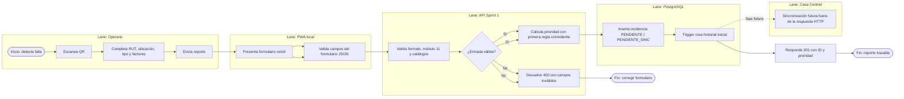
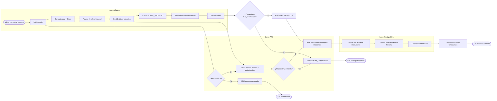
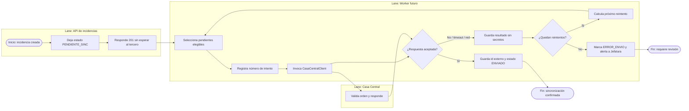
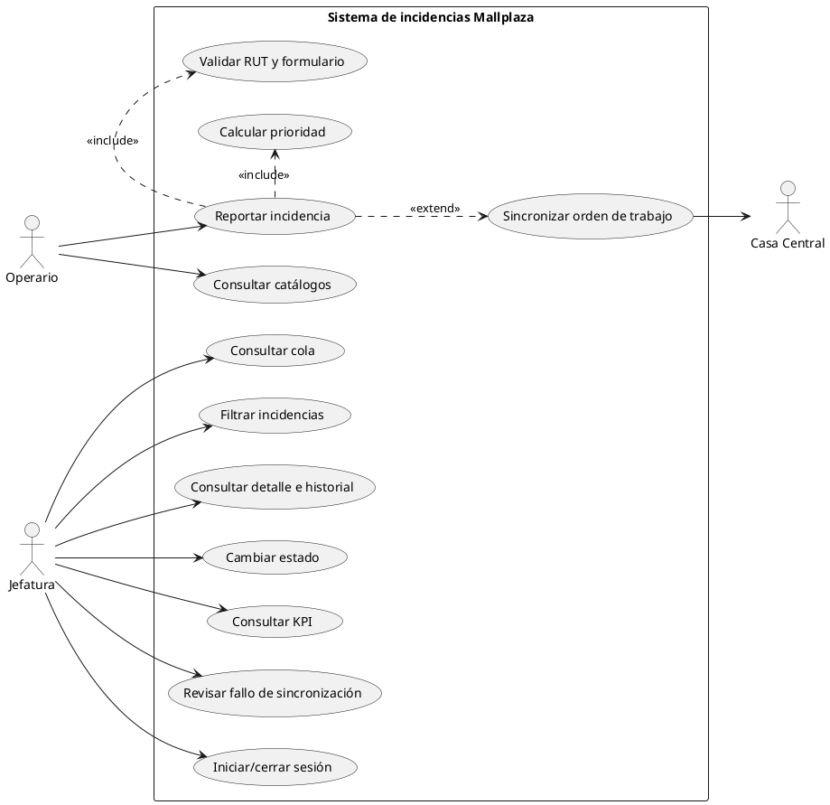
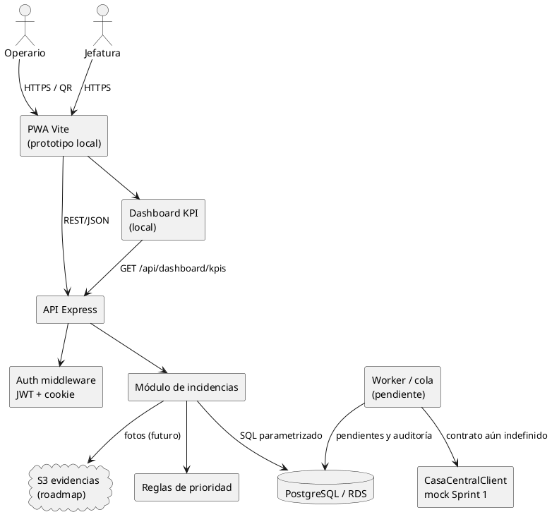
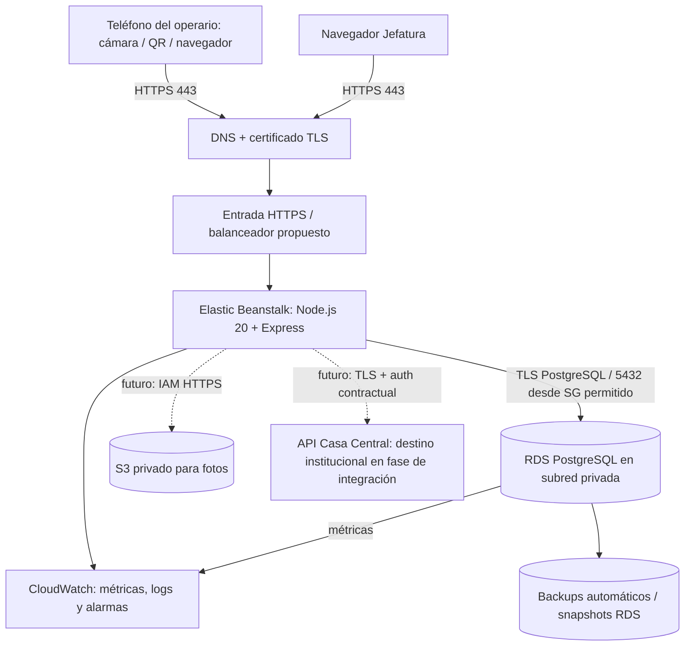

# Procesos, UML, topología y arquitectura

## Estado de los diagramas

Los tres procesos se representan con notación de flujo compatible con la lectura BPMN: evento de inicio/fin, tarea, compuerta exclusiva y carriles por responsable. Los bloques Mermaid son una representación de diseño para revisar en el equipo; antes de entregar BPMN 2.0 formal con pools, lanes, eventos y artefactos editables, se recomienda transcribirlos a Bizagi Modeler, Camunda Modeler u otra herramienta BPMN acordada. Los diagramas de arquitectura distinguen componentes implementados de componentes objetivo.

## 1. BPMN — Reportar y priorizar incidencia

**Objetivo:** capturar una falla de forma rápida y dejar evidencia trazable con prioridad determinista. **Participantes/carriles:** Operario, PWA local implementada, API, PostgreSQL y Casa Central (mock/pendiente). El QR distribuible no está implementado; se puede abrir el formulario local desde su ruta web.

**Subprocesos:** acceso por enlace/QR futuro; captura/validación; cálculo de prioridad; persistencia e historial; sincronización posterior. Regla ejecutada: (1) impacto y alto tránsito → Crítica; (2) riesgo o terceros → Alta; (3) alto tránsito o impacto → Media; (4) Baja. `tipo_falla` no cambia el resultado. El prototipo actual usa formulario web y API JSON, sin procesamiento de fotos.

## 2. BPMN — Gestionar cola priorizada y cerrar

**Objetivo:** permitir a Jefatura ordenar la cola, inspeccionar, avanzar el estado y conservar responsables/tiempos. No existe asignación formal de un técnico en el esquema actual; el modelo representa gestión de cola y seguimiento.

**Subprocesos:** autenticación; priorización de cola; revisión de detalle; inicio de proceso; resolución; cierre. La primera transición aceptada es `PENDIENTE → EN_PROCESO`; después `EN_PROCESO → RESUELTA`. La API devuelve 409 y el trigger impide transiciones inválidas incluso fuera de la API.

## 3. BPMN — Sincronizar con Casa Central y gestionar error

**Objetivo:** explicitar el proceso futuro que evita bloquear el reporte ante una dependencia externa. La implementación actual solo deja `PENDIENTE_SINC`, define cliente mock y tiene registros de auditoría; no hay worker ni reenvío operativo.

**Diseño de la fase de integración:** parametrizar endpoint, autenticación, mapeo de datos, idempotencia, respuestas, límites, backoff, máximo de reintentos, alertas y acción manual a partir de la especificación institucional. El mock permite desarrollar y demostrar el proceso mientras esa configuración pertenece a su fase propia.

## 4. UML — Casos de uso

Diagrama PlantUML para reproducir en un renderizador compatible. `PWA` y `Dashboard` son casos de uso objetivo, no funciones entregadas en Sprint 1.

## 5. UML — Componentes

En el prototipo actual existen PWA local, API, auth, reglas, módulo de incidencias, PostgreSQL local, dashboard KPI, auditoría base y cliente mock. No existen worker, bucket S3 provisionado ni integración real con Casa Central.

## 6. Topología de comunicación

El puerto PostgreSQL no debe exponerse a Internet: solo la aplicación accede al RDS mediante reglas de red. La administración debe usar canales controlados/VPN o servicios de sesión, nunca abrir indiscriminadamente 5432.

## 7. Infraestructura objetivo

1. **Dispositivo cliente:** teléfono con cámara/navegador, o equipo de Jefatura. No se requiere servidor físico local.
2. **Borde:** DNS, TLS y balanceador HTTPS; redirige solo a la aplicación.
3. **Cómputo:** Elastic Beanstalk administra despliegues y grupo EC2; para alta disponibilidad, varias instancias/zonas y auto scaling, a confirmar según presupuesto y criticidad.
4. **Datos:** RDS PostgreSQL privado; cifrado, monitoreo, backup automatizado y retención acordada. Multi-AZ para HA es propuesta sujeta a costo/objetivo de continuidad.
5. **Archivos:** bucket S3 privado para objetos de evidencia, con cifrado, política de ciclo de vida y acceso IAM mínimo. El esquema almacena `storage_key`, no el binario.
6. **Observabilidad y secretos:** CloudWatch, alarmas, retención de logs y Secrets Manager/Parameter Store. Ninguna credencial se incorpora al repositorio.
7. **Integración:** conexión de salida HTTPS a la interfaz institucional; el worker futuro procesa pendientes de forma idempotente usando su especificación técnica.

## 8. Arquitectura lógica

El sistema se separa en interfaz web/PWA, API REST, dominio, adaptadores y persistencia. El cliente nunca calcula la prioridad como autoridad; la API invoca función pura. La DB conserva integridad y trazabilidad. Los adaptadores de Casa Central/S3 aíslan proveedores externos y pueden sustituirse sin cambiar la regla central.

### Restricciones de seguridad transversales

- HTTPS/TLS 1.2 o superior en ambientes productivos.
- SQL parametrizado; `zod` en entrada; límites de solicitudes en login y alta.
- No registrar RUT, contraseña, cookie, token, API key ni payload de error sensible.
- RUT personal: acceso solo por necesidad operativa, respuesta pública sin dato; acordar finalidad, retención, derechos, encargado y control de acceso.
- Administrar secretos fuera del código; rotarlos; aplicar mínimo privilegio y separar ambientes.

## 9. Supuestos para discutir

- Jefatura es el único rol de Sprint 1; no se modeló asignación de técnico ni usuarios operarios.
- La ubicación de fecha de reporte usa `America/Santiago` y el filtro `hasta` incluye el día completo.
- RTO/RPO, región AWS, volumen esperado, retención de fotos, costo tope y disponibilidad objetivo requieren validación.
- Las recomendaciones de HA, alarmas y copias son diseño objetivo y no evidencian que estén configuradas.

## Referencias de arquitectura

- AWS Elastic Beanstalk: [uso con otros servicios y arquitectura en múltiples zonas](https://docs.aws.amazon.com/elasticbeanstalk/latest/dg/AWSHowTo.html), [consideraciones de tolerancia a fallas](https://docs.aws.amazon.com/elasticbeanstalk/latest/dg/concepts.concepts.design.html).
- AWS: [conexión de Elastic Beanstalk con RDS](https://docs.aws.amazon.com/elasticbeanstalk/latest/dg/AWSHowTo.RDS.html).
